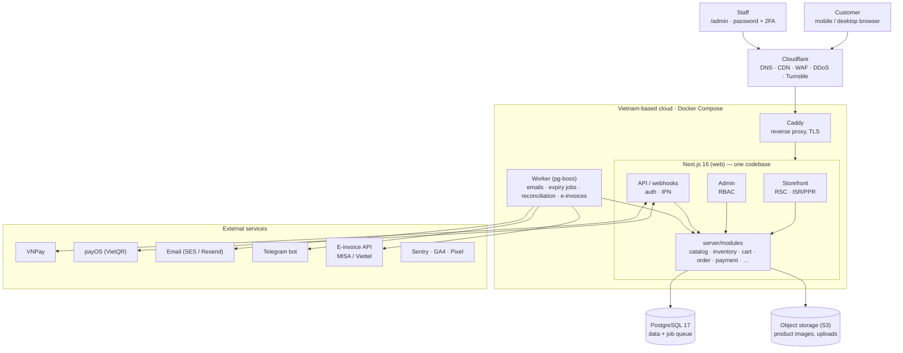
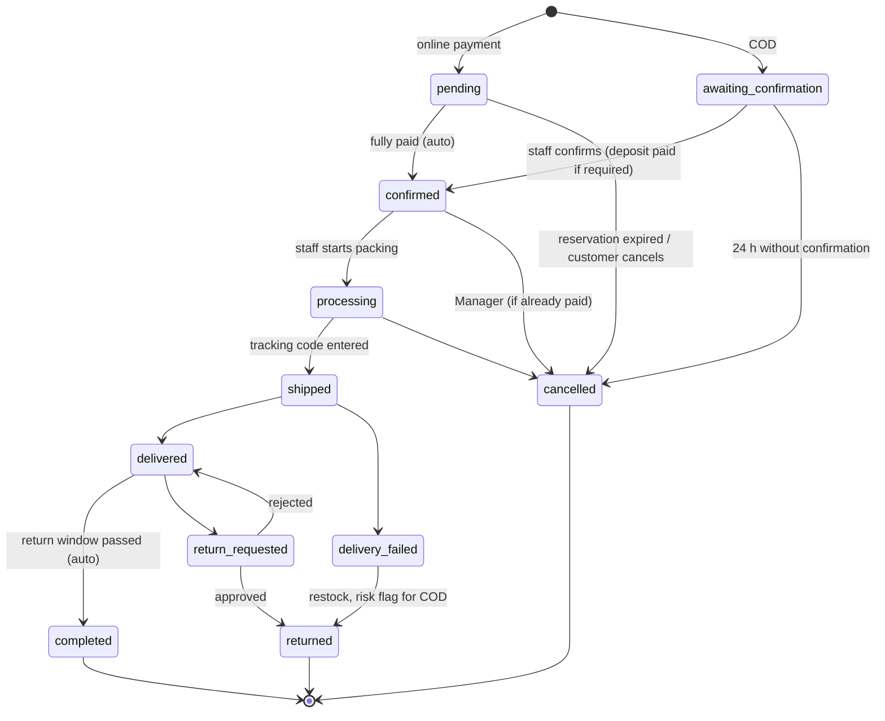

# Perfume Store — Architecture

> Status: approved for implementation · Last updated: 2026-11-11
> Audience: developers and Claude Code. This document is the technical source of truth.
> Decisions are recorded as ADRs in [`docs/adr/`](./adr/) (ADR-0001 … ADR-0022 = D01 … D22).
> If this document and an ADR disagree, the ADR wins; fix this document in the same PR.

## Table of contents

0. [Decisions and project conventions](#0-decisions-and-project-conventions)
1. [Requirements](#1-requirements)
2. [Scope: MVP and later phases](#2-scope-mvp-and-later-phases)
3. [System architecture](#3-system-architecture)
4. [Technology stack](#4-technology-stack)
5. [Sitemap and routes](#5-sitemap-and-routes)
6. [Database schema](#6-database-schema)
7. [Design system — premium luxury](#7-design-system--premium-luxury)
8. [UI components](#8-ui-components)
9. [Project structure](#9-project-structure)
10. [Customer features](#10-customer-features)
11. [Admin features](#11-admin-features)
12. [Security](#12-security)
13. [SEO](#13-seo)
14. [Performance and scalability](#14-performance-and-scalability)
15. [Delivery plan](#15-delivery-plan)
16. [Working with Claude Code](#16-working-with-claude-code)
17. [Risks and external inputs](#17-risks-and-external-inputs)

---

## 0. Decisions and project conventions

All decisions below are final. Items marked *external review* are implemented as written now; a lawyer or accountant reviews them at the go-live gate.

| ID | Decision | Rationale | ADR |
| --- | --- | --- | --- |
| D01 | B2C e-commerce store for authentic perfumes; Vietnam market; VND | Project scope | [0001](./adr/0001-product-scope.md) |
| D02 | Storefront bilingual: Vietnamese (default) + English from MVP; admin UI Vietnamese only | Foreign customers living in or visiting Vietnam; Vietnamese ops team | [0002](./adr/0002-bilingual-storefront.md) |
| D03 | Everything in the repo is English (code, identifiers, DB, comments, commits, PRs, docs, CLAUDE.md, prompts). Vietnamese only in user-facing content | Project rule | [0003](./adr/0003-english-only-codebase.md) |
| D04 | One `Product` per concentration; `Variant` = size/type; concentrations of one scent grouped by `product_lines` | Each concentration is a different formula with its own notes, reviews and SEO page | [0004](./adr/0004-product-per-concentration.md) |
| D05 | `orders.status` (fulfilment lifecycle) is separate from `orders.payment_status`; track `amount_paid` and `amount_due` | COD and deposits make money and goods move independently | [0005](./adr/0005-order-and-payment-status.md) |
| D06 | Online payment session 15 min (retry allowed); online stock reservation 30 min; unconfirmed COD auto-cancels after 24 h | Matches gateway session defaults; no indefinite holds | [0006](./adr/0006-payment-and-reservation-timeouts.md) |
| D07 | Payment secrets live only in env / secret store; never in the DB or editable in admin | Smaller attack surface; key rotation is a rare deploy-time task | [0007](./adr/0007-payment-secrets-in-env.md) |
| D08 | Reviews: members review from their account; guests review via a one-time emailed token link (30 days) after delivery | More verified-purchase reviews without forcing sign-up | [0008](./adr/0008-verified-reviews.md) |
| D09 | MVP includes manual orders, order edits before shipping, internal staff alerts, COD remittance reconciliation and a minimal privacy-request screen | Without them staff work outside the system and stock/money drift | [0009](./adr/0009-operational-features-in-mvp.md) |
| D10 | PostgreSQL 17; UUIDv7 ids generated in the application | Works on Vietnamese managed Postgres offerings; PG18 upgrade later is non-breaking | [0010](./adr/0010-postgres-17-uuidv7.md) |
| D11 | next-intl; Vietnamese without prefix (`/nuoc-hoa`), English under `/en` (`/en/perfumes`); English route folders with localized pathnames | Short URLs for the main market; localized slugs for SEO; code stays English | [0011](./adr/0011-i18n-routing.md) |
| D12 | Hosting on a Vietnam-based cloud behind Cloudflare (proxy, WAF, CDN); fallback: Cloudflare DNS-only | Data-localization duty for domestic companies; low latency | [0012](./adr/0012-hosting-vietnam-cloud.md) — *external review: lawyer* |
| D13 | Issue an e-invoice for every order automatically when it becomes `delivered`, via MISA meInvoice or Viettel S-Invoice behind an `integrations/einvoice` adapter; company invoices use the buyer's tax code | Safest legal option; no manual entry | [0013](./adr/0013-e-invoicing.md) — *external review: accountant* |
| D14 | Go-live end of week 18; hypercare weeks 19–20; reviews and wishlist stay in MVP | Trust signals matter for high-ticket items | [0014](./adr/0014-delivery-timeline.md) |
| D15 | No decant sales in MVP; keep `variant_type = decant` in the schema | Cosmetic labelling risk; "open bottle" inventory is complex | [0015](./adr/0015-no-decants-in-mvp.md) — *reopen after legal approval* |
| D16 | Nationwide COD; orders ≤ 5,000,000 VND need no deposit; above that a 20% deposit via VietQR/VNPay; values configurable | Keeps COD conversion, reduces failed high-value deliveries | [0016](./adr/0016-cod-policy.md) |
| D17 | Returns within 7 days with seal intact; defective/wrong/broken items replaced or 100% refunded, shop pays shipping; opened items not returnable except defects | Cosmetics industry norm | [0017](./adr/0017-returns-policy.md) — *external review: lawyer (wording)* |
| D18 | GHN primary carrier, GHTK backup; manual tracking entry in MVP; GHN API first in Phase 2 | Good API and coverage; one main carrier simplifies reconciliation | [0018](./adr/0018-shipping-carriers.md) |
| D19 | Internal alerts via Telegram bot + email; Zalo reserved for customer messaging (ZNS/OA in Phase 2) | Official free Bot API, integrates in hours | [0019](./adr/0019-internal-notifications.md) |
| D20 | One domain for both languages (English under `/en`) | Consolidated SEO authority, one certificate, one Search Console property | [0020](./adr/0020-single-domain.md) |
| D21 | English content is written or reviewed by an English editor; go-live requires ≥ 80% of active products with a published English translation | Machine translation hurts a luxury brand and SEO | [0021](./adr/0021-english-content-quality.md) |
| D22 | Online-only, single warehouse in MVP; physical store / POS in Phase 3 via `locations` | Avoid multi-channel stock sync until needed | [0022](./adr/0022-online-only-single-warehouse.md) |

---

## 1. Requirements

**Summary:** a B2C store selling authentic perfumes in Vietnam, built as a modular monolith on Next.js 16 + PostgreSQL, delivered in four milestones with a bilingual (vi/en) go-live at the end of week 18.

### 1.1 Business goals

- Sell authentic perfumes from multiple brands (niche + designer), plus gift sets. Decants come later (D15).
- Build trust: counterfeits are common in this category, so authenticity signals (origin, invoices, money-back guarantee) are the top conversion driver.
- Premium luxury experience: large imagery, refined typography, fast pages, minimal promotional noise.
- Operable by a small team (1–5 people): orders, stock and content in one admin.

### 1.2 Domain characteristics that shape the design

| Characteristic | Technical consequence |
| --- | --- |
| One scent comes in several concentrations (EDT, EDP, Parfum, Extrait); each concentration in several sizes (30/50/100 ml, travel, tester) | Each concentration is a `Product`; sizes/types are `ProductVariant`s holding price, stock, SKU, barcode; concentrations are linked through `product_lines` so the PDP can switch between them (D04) |
| Customers shop by scent: note pyramid (top/middle/base), scent family, gender, season, occasion, longevity, sillage | Structured tables `fragrance_notes`, `fragrance_families` and filterable attributes — never buried in free-text descriptions |
| High order value (typically 1–6 million VND) | COD carries failed-delivery risk → deposits for large orders, phone confirmation, risk flag per phone number |
| Frequently bought as gifts | Gift wrap, message card, option to hide prices on the packing slip |
| Counterfeit concerns | "Authenticity guarantee" page, import information, batch code, verified-purchase reviews |
| Fragile, flammable liquid | Weight-based shipping with surcharges; some carriers restrict air transport |
| Perfume is a cosmetic product in Vietnam | Store cosmetic notification number, responsible importer, origin, ingredients/warnings as structured fields |

### 1.3 Users

- **Guest:** browse, search and buy without an account (guest checkout is mandatory for conversion).
- **Member:** order history, address book, wishlist, reviews, preferred language; loyalty in Phase 2.
- **Staff:** Owner, Manager, Staff (orders + stock), Editor (content) — role-based access.

### 1.4 Assumptions (confirmed)

- Main market Vietnam, currency VND; storefront in Vietnamese (default) and English; admin in Vietnamese.
- One warehouse in MVP; catalogue under 3,000 SKUs in year one.
- Operated by a Vietnamese company as a seller's own e-commerce website (not a marketplace).
- Staff process orders on desktop; admin must also work well on tablets.

### 1.5 Legal constraints (built into the design)

- **E-commerce Law No. 122/2025/QH15**, effective 2026-07-01, with Decree 248/2026/ND-CP: disclose seller information, product information and policies; notify the website to the e-commerce authority before selling.
- **Personal Data Protection Law No. 91/2025/QH15** and **Decree 356/2025/ND-CP**, effective 2026-01-01 (replacing Decree 13/2023); **Decree 330/2026/ND-CP** on penalties, effective 2026-08-19. Consequences: recorded consent, data export/deletion rights, processing logs.
- **Decree 53/2022/ND-CP (Cybersecurity Law):** domestic companies collecting data of users in Vietnam fall under the duty to store that data in Vietnam → primary database hosted in Vietnam (D12).
- **Two-level administrative units** (province – ward) since 2025-07: address forms use two levels; keep an optional legacy district field for carriers that still require it.
- **Cosmetics:** cosmetic notification number, responsible importer, Vietnamese sub-label. Decant repackaging may conflict with labelling rules (D15).
- **E-invoices:** issued for every order (D13).
- **Foreign processors of personal data:** Cloudflare (terminates TLS at the edge), email provider, Sentry, GA4 must be listed in the privacy policy and in the cross-border transfer dossier.

> This is a technical analysis, not legal advice. A lawyer reviews it before go-live.

---

## 2. Scope: MVP and later phases

**MVP = enough to sell, operate and stay legal, in two languages.** A feature is in the MVP only if without it we cannot sell, staff cannot process orders, customers lose trust, or we break the law.

| Area | MVP | Phase 2 | Phase 3 |
| --- | --- | --- | --- |
| Languages | Storefront vi + en: UI, product/brand/category/journal/policy content, transactional emails, localized URLs, hreflang; admin edits translations in vi/en tabs | Machine-translation suggestions in admin (human-approved), bilingual admin | Third language, multi-currency |
| Catalogue | Brands, categories, collections, product lines; products + variants; notes, families; cosmetics compliance fields; fixed gift sets | Custom bundles, discovery sets, product comparison | — |
| Search | Postgres full-text per locale, accent-insensitive, typo-tolerant; filters: brand, gender, family, concentration, size, price | Meilisearch/Typesense, autocomplete, synonyms | Semantic "describe a scent" search |
| Discovery | Related products (same family/brand), new arrivals, best sellers | Fragrance Finder quiz (5–7 questions), recently viewed | Personalised recommendations |
| Cart & checkout | Guest + member carts (merged on sign-in), one-page guest checkout, gift wrap + card, coupons, payment retry | One-click buy for members, abandoned-cart email | Pre-orders, decant subscription |
| Payments | COD (threshold + deposit), VietQR bank transfer with automatic confirmation (payOS), VNPay (cards/QR) | MoMo, ZaloPay, 0% instalments | BNPL, international gateway |
| Shipping | Zone + weight rates, free-shipping threshold, manual tracking codes, manual COD reconciliation | GHN/GHTK API (labels, rates, status webhooks, automatic COD reconciliation) | Multi-warehouse, same-day delivery |
| Accounts | Email + password, Google; orders, addresses, wishlist, preferred language; data export/deletion | Phone OTP / Zalo login, passkeys | Mobile app |
| Trust | Moderated reviews with "verified purchase" (members or guest token link), authenticity page, returns policy | Photo reviews, product Q&A | Online batch-code verification |
| Marketing | Basic coupons, home banners, journal, newsletter signup, GA4 + Meta Pixel (consent-gated) | Loyalty, flash sales, back-in-stock alerts, Zalo ZNS, Meta CAPI, Google Merchant feed | Affiliates/KOC, Shopee/TikTok Shop sync |
| Admin | KPI dashboard, products + translations, inventory, orders (manual creation, edits before shipping), staff alerts, customers, coupons, reviews, content, settings, RBAC, audit log, minimal privacy requests | Advanced reports, CSV import/export, purchase receipts | POS, multi-warehouse, accounting/ERP integration |
| Legal | Policy pages (vi + en; Vietnamese prevails), seller information, cookie consent, consent log, notification badge, automatic e-invoices (D13) | Automated data-subject request SLAs | — |

**Deliberately deferred, not dropped:** MoMo/ZaloPay (VNPay QR already works with most banking apps), carrier APIs (low early volume; manual entry is faster than integrating), loyalty (needs repeat-purchase data), a dedicated search engine (Postgres is enough below ~10,000 SKUs). The MVP schema already leaves room for these.

---

## 3. System architecture

**Decision: modular monolith.** One Next.js application (storefront, admin, API), one background worker, one PostgreSQL database. Business logic is split into domain modules with strict boundaries so any module can later become a service without a rewrite.



All traffic passes Cloudflare and Caddy. The web app and the worker share `server/modules` and the same database. Payment gateways call back into the API through IPN/webhooks.

### 3.1 Alternatives considered

| Option | Strength | Why not for MVP |
| --- | --- | --- |
| Microservices | Independent scaling | Operational, debugging and deployment cost far too high for a small team at < 100 orders/day |
| Headless commerce (Medusa v2, Saleor) + Next.js storefront | Ready-made cart, orders, promotions | Another backend to operate; Vietnamese payments/shipping still need custom plugins; harder to tailor admin to perfume workflows |
| SaaS (Haravan, Sapo, Shopify) | Live in days | Limited bespoke luxury design, monthly/transaction fees, hard to model structured scent data and the Fragrance Finder |
| Separate admin app | Security isolation | Doubles deployment config; route groups + server-side permission checks are sufficient. Can split in Phase 3 |

### 3.2 Layers

1. **Presentation** (`app/`): React Server Components by default; Client Components only for interactivity (gallery, variant picker, cart, forms).
2. **Entry points:** Server Actions for mutations from our own UI; Route Handlers (`app/api/*`) for payment/shipping webhooks, auth and public endpoints.
3. **Application services** (`server/modules/*/service.ts`): use cases such as `placeOrder`, `confirmPayment`, `adjustStock`. All permission checks and Zod validation happen here, never only in the UI.
4. **Repositories** (`server/modules/*/repo.ts`): Drizzle queries. Only the owning module writes to its tables.
5. **Integrations** (`server/integrations/*`): adapters for VNPay, payOS, email, storage, Telegram, e-invoicing, carriers — one interface per capability so providers can be swapped without touching domain code.

### 3.3 Domain modules

| Module | Responsibility | Owned tables |
| --- | --- | --- |
| `catalog` | Products, variants, product lines, brands, categories, notes, families, media, translations | products, product_variants, product_lines, brands, categories, collections, fragrance_*, media, *_translations |
| `inventory` | Stock levels, time-limited reservations, movement log | locations, inventory_items, stock_reservations, stock_movements |
| `cart` | Guest and member carts | carts, cart_items |
| `checkout` + `order` | Pricing, order creation (web + manual), order edits, state machine, e-invoice trigger | orders, order_items, order_addresses, order_events |
| `payment` | Payment initiation, IPN/webhook verification, retries, COD remittances, refunds | payments, payment_events, refunds, cod_remittances, cod_remittance_orders |
| `shipping` | Rates, shipments | shipping_zones, shipping_rates, shipping_rate_translations, shipments |
| `promotion` | Coupons, rules, redemptions | coupons, coupon_redemptions |
| `customer` + `auth` | Accounts, addresses, wishlist, consents, privacy requests | users, sessions, accounts, addresses, wishlists, consents, privacy_requests |
| `review` | Reviews, review invitations, moderation | reviews, review_invitations |
| `content` | Banners, journal posts, static pages, menus, redirects | posts, pages, banners, navigation_menus, redirects, *_translations |
| `notification` | Customer emails (in the order's locale), internal staff alerts (email + Telegram) | notification_logs |
| `admin` | Permissions, audit, settings | audit_logs, settings |

**Module communication rules:** module A calls only module B's public `index.ts`, never B's `repo.ts`. Side effects (emails, alerts, e-invoices, stats) go through the job queue using a **transactional outbox**: the job is enqueued in the same database transaction as the business change.

### 3.4 Order and payment flow

1. Customer clicks "Place order" → Server Action `placeOrder` recomputes every price on the server (client prices are never trusted) and stores the session `locale` on the order.
2. In one transaction: lock stock rows (`SELECT … FOR UPDATE`), create the order, create `stock_reservations` with `expires_at`, record the coupon redemption, enqueue outbox jobs. Online payment, and COD that needs a deposit (D16): `status = pending`, reservation 30 min. Other COD: `status = awaiting_confirmation`, reservation 24 h (D06). The cart row is locked first, so a repeated submit with the same checkout key returns the first order; checkouts using the same coupon are serialized (transaction-scoped advisory lock) so its per-customer limit holds under concurrency.
3. **Online (VNPay / VietQR):** create a `payments` row expiring in 15 min → redirect or show the QR. If the session expires while the reservation is still valid, the customer can "Retry payment", creating a new payment (method may change).
4. The gateway calls the IPN/webhook → verify signature + amount + idempotency → add to `amount_paid`. When fully paid: `payment_status = paid`, order moves to `confirmed`, reservations are committed to real stock deductions. The return URL only displays status; it never changes it. An IPN arriving after cancellation records the money, adds the order to the refund queue and alerts staff.
5. **COD ≤ threshold:** staff confirm by phone/Zalo within 24 h → `confirmed`; otherwise a job cancels the order and releases stock. **COD > threshold (D16):** the customer pays a 20% deposit through steps 3–4 → `payment_status = partially_paid`, order `confirmed`; the carrier collects the balance.
6. **COD reconciliation:** when the carrier remits money, staff create a `cod_remittances` record and tick the orders included → `payment_status = paid`.
7. **Manual orders:** staff create orders for phone/Zalo customers (`source = admin`) with COD, manually confirmed bank transfer (Manager confirms receipt) or a payment link sent to the customer. Manual orders go through the same `placeOrder` pricing and stock rules.
8. **Order edits:** allowed before `shipped` (address, items, quantities, shipping fee); totals are recomputed, reservations adjusted, a diff written to `order_events`. If the new total exceeds the amount paid → send a payment link for the difference; if lower → create a refund.
9. **E-invoice (D13):** when an order becomes `delivered`, an outbox job issues the e-invoice through the adapter (retry with backoff; result stored in `einvoice_ref`).
10. After each important step, the worker sends the customer email (in the order's locale) and internal alerts (new order, high-value COD, suspicious IPN, low stock).

### 3.5 State machines (D05)

Two independent states: `status` (fulfilment lifecycle) is changed only by the `order` module through `transitionOrder()`; `payment_status` is changed only by the `payment` module (verified IPN, COD remittance, refund). Every change writes an `order_events` row (who, when, reason, diff).



`payment_status`: `unpaid` → `partially_paid` → `paid` → `partially_refunded` | `refunded`. Gateway refunds call the provider API when supported; COD and bank-transfer refunds are manual and recorded in `refunds` with proof.

### 3.6 Internationalization (D02, D11)

- **Library:** next-intl (App Router, Server Components, localized pathnames, typed messages).
- **Routing:** `localePrefix: 'as-needed'` — Vietnamese without prefix, English under `/en`. Route folders are English (`app/[locale]/(shop)/perfumes/[slug]`); Vietnamese pathnames are declared in `src/i18n/routing.ts` (`/perfumes` → `/nuoc-hoa`). `/admin` and `/api` live outside `[locale]`.
- **Locale choice:** no automatic redirect on `Accept-Language` (hurts SEO and link sharing). Show a one-time suggestion banner; persist the choice in the `NEXT_LOCALE` cookie and `users.locale`.
- **UI strings:** `messages/vi.json` and `messages/en.json`, English namespaced keys (`checkout.placeOrder`). CI fails if the key sets differ. Admin uses the `admin` namespace, Vietnamese only in MVP.
- **DB content:** `<entity>_translations` tables keyed by `(entity_id, locale)` for translatable fields (name, slug, description, SEO, brand story). Non-translatable fields (SKU, price, size, brand name) stay on the base table. Translation tables are chosen over JSONB because slugs must be unique per locale and search indexes are per locale.
- **Missing translations:** each translation has `is_published`. A product without a published English translation does not appear on the English storefront or English sitemap; the language switcher sends the user to the nearest English listing. Vietnamese is required to publish.
- **Formatting:** money always VND (`1.250.000 ₫` in vi, `₫1,250,000` in en); dates per locale; timezone `Asia/Ho_Chi_Minh`. Phone numbers and addresses remain Vietnamese format (English forms show province/ward names without diacritics).
- **Emails & payments:** transactional emails use `orders.locale`; VNPay receives `vnp_Locale = vn | en`.
- **SEO:** `alternates.languages` (vi, en, x-default = vi), per-locale canonical, sitemap alternates (section 13).
- **Legal:** terms and policies exist in English; the Vietnamese version prevails in case of discrepancy.

---

## 4. Technology stack

**Core: Next.js 16 (App Router) + TypeScript + PostgreSQL 17 + Drizzle ORM + Better Auth + next-intl + Tailwind CSS v4 + shadcn/ui**, packaged with Docker, hosted in Vietnam behind Cloudflare. Next.js 16.x is the current stable line (16.4.1 released 2026-10-15); pin the minor version when scaffolding.

### 4.1 Decision table

| Layer | Choice | Why | Alternatives considered |
| --- | --- | --- | --- |
| Framework | Next.js 16, App Router, Turbopack | SSR/ISR for SEO; Server Components ship less JS; Cache Components + `cacheTag` refresh product pages as soon as admin saves; one codebase for storefront and admin | Remix / React Router 7, Nuxt |
| Language | TypeScript (strict) | End-to-end types from DB to UI; fewer errors in generated code | — |
| Runtime | Node.js 24 LTS | Long-term support; Next 16 requires Node ≥ 20.9 | Bun (not needed) |
| Database | PostgreSQL 17 | ACID transactions for stock and orders; JSONB for flexible attributes; full-text (`simple` config) + `unaccent` + `pg_trgm` instead of a search engine in MVP; UUIDv7 generated in the app because PG17 has no `uuidv7()` (D10) | MySQL, MongoDB (poor fit for orders) |
| ORM | Drizzle ORM + drizzle-kit migrations | SQL-first, no codegen step, easy Postgres-specific queries (`FOR UPDATE`, `tsvector`, partial indexes, triggers via SQL migrations) | Prisma 7 |
| Auth | Better Auth (email/password, Google, DB sessions, TOTP plugin) | User data stays in our DB; 2FA/OTP/passkey plugins; configure `usePlural` and UUID ids to match schema conventions. Auth.js joined Better Auth in 2025-09 | Clerk (data outside Vietnam, per-MAU pricing) |
| i18n | next-intl | App Router + RSC support, localized pathnames (`/nuoc-hoa` ↔ `/en/perfumes`), typed messages, locale-aware formatting | Paraglide, custom |
| Validation | Zod v4 | One schema for forms, Server Actions and webhooks | Valibot |
| UI | Tailwind CSS v4 + shadcn/ui (Radix) | Components owned in the repo, fully restyled to the luxury design system; accessible primitives | MUI, Chakra |
| Forms | React Hook Form + Zod resolver | Performs well on long forms (checkout, product editor) | Conform |
| URL state | nuqs | Filters/sorting in the URL → shareable and indexable | — |
| Client state | Zustand (mini-cart and transient UI only) | Tiny, no boilerplate; server data comes through RSC | Redux |
| Admin tables | TanStack Table | Server-side filtering, sorting, pagination | AG Grid |
| Rich text | Tiptap | Product descriptions, journal; stored as JSON, rendered to sanitized HTML | Lexical |
| Animation | Motion (framer-motion) | Restrained motion; respects `prefers-reduced-motion` | GSAP |
| Background jobs | pg-boss + worker container | No extra infrastructure; retries, cron, delayed jobs. Worker bundled with tsup (default conditions, no `react-server`) to share `server/modules`; cache revalidation through an HMAC-signed internal endpoint; outbox inside Drizzle transactions via pg-boss `fromDrizzle` (ADR-0023) | BullMQ + Redis, Inngest |
| Cache / rate limit | Next.js data cache; Postgres-backed rate limit + Cloudflare WAF in MVP; Redis (Valkey) when running multiple instances | Fewer moving parts in MVP | Upstash |
| File storage | S3-compatible object storage in Vietnam + Cloudflare CDN | `next/image` for product images; S3 adapter keeps the provider swappable | Cloudinary |
| Payments | VNPay (`vnpay` npm package), payOS (VietQR), COD | VNPay covers cards and bank QR; payOS confirms bank transfers automatically via webhook | MoMo, ZaloPay (Phase 2) |
| E-invoicing | MISA meInvoice or Viettel S-Invoice API behind an adapter | Automatic invoice per delivered order (D13); retries; `einvoice_ref` stored; provider swappable | Manual issuing from accounting software |
| Email | React Email + SES or Resend | Templates in React, localized | — |
| Internal alerts | Telegram Bot API | Free, official, quick to integrate (D19) | Zalo group webhooks (unofficial) |
| Monitoring | Sentry (errors + performance, PII scrubbing), Uptime Kuma, JSON logs (pino) | Catch checkout errors early | Datadog |
| Analytics | GA4 + Meta Pixel via Google Tag Manager, loaded only after consent | Conversion tracking, ads | PostHog (Phase 2) |
| Testing | Vitest (unit/integration), Testcontainers (real Postgres), Playwright (E2E), MSW (gateway mocks) | E2E mandatory for checkout in both locales | Jest, Cypress |
| Code quality | ESLint + Prettier, Husky + lint-staged, pnpm, Conventional Commits | Consistent code before commit | Biome |
| CI/CD | GitHub Actions → build images → deploy | Lint, typecheck, tests, i18n check, migrations | — |

### 4.2 Infrastructure

**Chosen: Vietnam-based cloud** (for example VNG Cloud, Viettel Cloud, FPT Cloud, BizFly) because of the data-localization requirement and low latency for domestic customers (D12).

- One VM, 4 vCPU / 8 GB, running Docker Compose: `web` (Next.js `output: "standalone"`), `worker` (pg-boss), `caddy` (reverse proxy + TLS).
- Managed PostgreSQL from the same provider (or a dedicated VM): daily backups + point-in-time recovery, 14-day retention.
- S3-compatible object storage in Vietnam for images and files.
- Cloudflare in front (DNS, CDN, WAF, DDoS protection, Turnstile); caches images and static assets. Fallback if legal review requires it: DNS-only mode.
- Environments: `local` → `staging` (small separate VM, VNPay/payOS sandboxes) → `production`.

**Rejected for now: Vercel + Postgres in Singapore** — least operational work, but personal data would be stored outside Vietnam. Code must not depend on Vercel-specific features so this remains possible after legal review.

Foreign services that process personal data (Cloudflare, email provider, Sentry, GA4) count as cross-border transfers: list them in the privacy policy and configure Sentry to drop PII.

**Estimated MVP infrastructure cost:** roughly 1.5–4 million VND/month (VM + managed DB + storage + email), excluding payment fees and the e-invoice subscription. Approximate; confirm with provider quotes.

---

## 5. Sitemap and routes

**Every storefront page has two URLs: Vietnamese without prefix and English under `/en`. Route folders in code are always English** (D03, D11). Content slugs (products, brands, …) come from `*_translations` per locale. Admin and API have no locale.

Render column: **ISR** = static + tag-based revalidation; **PPR** = static shell + streamed dynamic islands; **Dynamic** = rendered per request.

### 5.1 Storefront

| Route folder (code) | Vietnamese URL | English URL | Page | Render | Phase |
| --- | --- | --- | --- | --- | --- |
| `(shop)/page` | `/` | `/en` | Home | ISR | MVP |
| `(shop)/perfumes` | `/nuoc-hoa` | `/en/perfumes` | All products + filters | PPR | MVP |
| `(shop)/categories/[slug]` | `/danh-muc/[slug]` | `/en/categories/[slug]` | Category | PPR | MVP |
| `(shop)/brands` | `/thuong-hieu` | `/en/brands` | Brands A–Z | ISR | MVP |
| `(shop)/brands/[slug]` | `/thuong-hieu/[slug]` | `/en/brands/[slug]` | Brand page | PPR | MVP |
| `(shop)/collections/[slug]` | `/bo-suu-tap/[slug]` | `/en/collections/[slug]` | Curated collection | PPR | MVP |
| `(shop)/scent-families/[slug]` | `/nhom-huong/[slug]` | `/en/scent-families/[slug]` | Scent family landing (SEO) | ISR | MVP |
| `(shop)/products/[slug]` | `/san-pham/[slug]` | `/en/products/[slug]` | Product detail; variant via `?v=<sku>` | PPR | MVP |
| `(shop)/search` | `/tim-kiem` | `/en/search` | Search results (noindex) | Dynamic | MVP |
| `(shop)/cart` | `/gio-hang` | `/en/cart` | Cart | Dynamic | MVP |
| `(checkout)/checkout` | `/thanh-toan` | `/en/checkout` | One-page checkout | Dynamic | MVP |
| `(checkout)/checkout/result` | `/thanh-toan/ket-qua` | `/en/checkout/result` | Payment result, retry | Dynamic | MVP |
| `(shop)/order-lookup` | `/tra-cuu-don-hang` | `/en/order-lookup` | Guest order lookup | Dynamic | MVP |
| `(shop)/review/[token]` | `/danh-gia/[token]` | `/en/review/[token]` | Review via emailed link (noindex) | Dynamic | MVP |
| `(auth)/sign-in`, `sign-up`, `forgot-password`, `reset-password` | `/dang-nhap`, `/dang-ky`, `/quen-mat-khau`, `/dat-lai-mat-khau` | `/en/sign-in`, … | Authentication | Dynamic | MVP |
| `(shop)/account` | `/tai-khoan` | `/en/account` | Account overview | Dynamic | MVP |
| `account/orders`, `account/orders/[code]` | `/tai-khoan/don-hang/…` | `/en/account/orders/…` | Order history + detail | Dynamic | MVP |
| `account/addresses`, `account/wishlist`, `account/profile`, `account/privacy` | `/tai-khoan/dia-chi`, `/yeu-thich`, `/ho-so`, `/quyen-rieng-tu` | `/en/account/addresses`, … | Addresses, wishlist, profile, privacy centre | Dynamic | MVP |
| `account/rewards` | `/tai-khoan/diem-thuong` | `/en/account/rewards` | Loyalty | Dynamic | Phase 2 |
| `(shop)/journal`, `journal/[slug]`, `journal/topics/[slug]` | `/tap-chi/…` | `/en/journal/…` | Journal | ISR | MVP |
| `(shop)/about`, `authenticity`, `contact`, `faq` | `/gioi-thieu`, `/cam-ket-chinh-hang`, `/lien-he`, `/cau-hoi-thuong-gap` | `/en/about`, `/en/authenticity`, `/en/contact`, `/en/faq` | Information pages | ISR | MVP |
| `(shop)/policies/[slug]` | `/chinh-sach/[slug]` | `/en/policies/[slug]` | Returns, shipping, payment, privacy, terms, cookies | ISR | MVP |
| `(shop)/fragrance-finder` | `/tim-mui-huong` | `/en/fragrance-finder` | Quiz | Dynamic | Phase 2 |
| `(shop)/compare` | `/so-sanh` | `/en/compare` | Comparison | Dynamic | Phase 2 |

### 5.2 Admin (`/admin`, no locale, noindex, requires sign-in + 2FA-verified session)

| Route | Purpose | Phase |
| --- | --- | --- |
| `/admin/login` | Staff sign-in (email + password + TOTP; no OAuth) | MVP |
| `/admin` | Dashboard: revenue, orders awaiting action, low stock, missing translations | MVP |
| `/admin/orders`, `/admin/orders/new`, `/admin/orders/[id]` | List, manual order, detail, edit, transitions, printing | MVP |
| `/admin/products`, `/new`, `/[id]` | Products + variants + media + vi/en translations + SEO + cosmetics compliance | MVP |
| `/admin/catalog/brands`, `/product-lines`, `/categories`, `/collections`, `/notes`, `/families` | Catalogue data (translatable) | MVP |
| `/admin/inventory`, `/admin/inventory/movements` | Stock levels, adjustments, movement log | MVP |
| `/admin/customers`, `/admin/customers/[id]` | Customers (Owner, Manager) | MVP |
| `/admin/promotions/coupons` | Coupons | MVP |
| `/admin/reviews` | Review moderation | MVP |
| `/admin/content/banners`, `/posts`, `/pages`, `/navigation`, `/redirects` | Bilingual content | MVP |
| `/admin/shipping` | Zones and rates | MVP |
| `/admin/payments`, `/admin/payments/cod-remittances` | Transactions, refunds, COD reconciliation | MVP |
| `/admin/privacy-requests` | Data export/deletion requests with due dates (minimal) | MVP |
| `/admin/settings` | Company info, COD threshold/deposit, gift-wrap fee, alert channels, SEO defaults (no payment secrets — D07) | MVP |
| `/admin/staff`, `/admin/audit-log` | Staff, roles, audit trail | MVP |
| `/admin/reports` | Advanced reports | Phase 2 |
| `/admin/loyalty`, `/admin/flash-sales` | Advanced marketing | Phase 2 |

### 5.3 System routes

- `/sitemap.xml` (index, split by content type, each URL with vi/en alternates), `/robots.txt`, per-locale dynamic `opengraph-image`.
- `/api/auth/[...all]` (Better Auth), `/api/webhooks/vnpay`, `/api/webhooks/payos`, `/api/webhooks/shipping/[carrier]` (Phase 2).
- `/api/internal/revalidate` (called by the worker, HMAC-signed), `/api/health`, `/feeds/google-merchant.xml` (Phase 2).

---

## 6. Database schema

**About 72 MVP tables in 10 groups (12 `*_translations` tables), PostgreSQL 17, managed with Drizzle migrations.** All names, enums and comments are English (D03). The schema already leaves room for multiple warehouses, MoMo, carrier APIs and decants.

### 6.1 Conventions

- Primary key `id uuid` with UUIDv7 values generated in the app (`uuidv7` package via `src/server/lib/ids.ts`) (D10); join tables use composite keys.
- Money: `bigint` in VND (đồng); never floats. Time: `timestamptz` in UTC, displayed in `Asia/Ho_Chi_Minh`. Every table has `created_at` and `updated_at`.
- Translations: translatable fields live in `<entity>_translations` keyed by `(entity_id, locale)`; `locale` is an enum `('vi','en')`; slugs unique on `(locale, slug)`; `is_published` per translation; `vi` required before publishing.
- Soft delete (`deleted_at`) for products, brands, categories and posts; hard delete elsewhere.
- Statuses use `pgEnum`; tables/columns are `snake_case`, plural; Better Auth configured with `usePlural`.
- Orders store **snapshots** (names in the order's locale, prices, addresses).
- Extensions: `unaccent`, `pg_trgm`, `citext`; an `immutable_unaccent()` wrapper so `unaccent` can be used in indexes.

### 6.2 Tables by group

```dbml
// Every table: id uuid (UUIDv7 from app), created_at, updated_at (timestamptz).
// Money: bigint VND. Locale: enum('vi','en'). "?" = nullable. UK = unique.

// ===== AUTH & CUSTOMERS =====
users            id, email citext UK, email_verified, name, phone, image, birthday?, gender?,
                 role enum(customer, owner, manager, staff, editor) default customer,
                 locale default 'vi', two_factor_enabled, banned, marketing_opt_in,
                 cod_risk_flag bool default false, last_login_at, deleted_at
sessions         // Better Auth: user_id FK, token UK, expires_at, ip_address, user_agent,
                 // two_factor_verified bool (required to access /admin)
accounts         // Better Auth: OAuth links + password hash (scrypt)
verifications    // Better Auth: email verification / password reset tokens
two_factors      // Better Auth: encrypted TOTP secret, backup codes
addresses        user_id FK, full_name, phone, province_code FK, ward_code FK,
                 legacy_district?, street, is_default
provinces        code PK, name, name_ascii, slug          // seeded, 2-level admin units
wards            code PK, province_code FK, name, name_ascii, slug
wishlists        PK(user_id, product_id)
consents         user_id?, email?, phone?, purpose enum(terms, privacy, marketing_email,
                 marketing_sms, analytics, ads), granted bool, policy_version, locale,
                 source, ip, user_agent                    // append-only, never UPDATE
newsletter_subscribers  email UK, locale, status, consent_id FK, source
privacy_requests user_id?, email, type enum(export, delete, correct, withdraw_consent),
                 status enum(received, in_progress, completed, rejected), due_at,
                 handled_by?, completed_at?, note

// ===== CATALOG =====
brands           name (brand names are not translated), country, logo_media_id,
                 is_featured, status, deleted_at
brand_translations       PK(brand_id, locale), slug, story jsonb, seo_title,
                         seo_description, is_published, UK(locale, slug)
categories       parent_id?, sort_order, deleted_at
category_translations    PK(category_id, locale), name, slug, description, seo_title,
                         seo_description, is_published, UK(locale, slug)
collections      kind enum(manual, rule), rules jsonb?, hero_media_id, starts_at?,
                 ends_at?, is_active
collection_translations  PK(collection_id, locale), name, slug, description, seo_title,
                         seo_description, is_published, UK(locale, slug)
collection_products      PK(collection_id, product_id), position
fragrance_families       image_media_id
fragrance_family_translations  PK(family_id, locale), name, slug, description, UK(locale, slug)
fragrance_notes          image_media_id
fragrance_note_translations    PK(note_id, locale), name, slug, description, UK(locale, slug)
product_lines    brand_id FK, name                 // e.g. "Bleu de Chanel": groups EDT/EDP/Parfum
products         brand_id FK, product_line_id?, gender enum(male, female, unisex),
                 concentration enum(edc, edt, edp, parfum, extrait, other),
                 release_year?, perfumer?, longevity 1-5?, sillage 1-5?,
                 seasons text[], occasions text[],
                 status enum(draft, active, archived), is_featured, published_at,
                 rating_avg numeric(2,1), rating_count int,           // denormalized
                 country_of_origin, cosmetic_notification_no, responsible_importer,
                 ingredients?, warnings?,                             // cosmetics compliance
                 deleted_at
product_translations     PK(product_id, locale), name, slug, subtitle, description jsonb,
                         seo_title, seo_description, is_published,
                         search_vector tsvector,  // maintained by trigger, see 6.3
                         UK(locale, slug)
product_variants sku UK, product_id FK, barcode?, size_ml int,
                 variant_type enum(full_size, decant, travel, tester, gift_set),
                 // decant exists for later use; not sold in MVP (D15)
                 price, compare_at_price?, cost_price?, weight_g int,
                 is_default, is_active, position
                 // display label ("100ml", "Travel 10ml") is built from size_ml +
                 // variant_type via messages/*.json, not stored
product_categories       PK(product_id, category_id)
product_families         PK(product_id, family_id), is_primary
product_notes            PK(product_id, note_id, layer), layer enum(top, middle, base), position
media            storage_key UK, url, width, height, mime, size_bytes, blur_data_url
media_translations       PK(media_id, locale), alt
product_media            PK(product_id, media_id), variant_id?, position

// ===== INVENTORY =====
locations        name, address, is_default                          // MVP: one row (D22)
inventory_items  PK(variant_id, location_id), on_hand int, reserved int,
                 low_stock_threshold int default 3,
                 CHECK(on_hand >= 0 AND reserved >= 0 AND reserved <= on_hand)
stock_reservations  order_id FK, variant_id, location_id, quantity, expires_at,
                 status enum(active, committed, released)
stock_movements  variant_id, location_id, delta int, reason enum(purchase, sale, reserve,
                 release, adjustment, return, damage), ref_type, ref_id, note,
                 actor_id?                                           // append-only

// ===== CART =====
carts            user_id?, token_hash UK, locale, status enum(active, converted, abandoned),
                 coupon_code?, gift_wrap, gift_message?, hide_prices, expires_at
cart_items       cart_id FK, variant_id FK, quantity, price_when_added, UK(cart_id, variant_id)

// ===== ORDERS =====
orders           code UK,                     // "PF-261111-7K3Q", readable over the phone
                 user_id?, email, phone, customer_name, locale,
                 source enum(web, admin), created_by?,        // staff id for manual orders
                 status enum(pending, awaiting_confirmation, confirmed, processing,
                   shipped, delivered, completed, cancelled, delivery_failed,
                   return_requested, returned),
                 payment_status enum(unpaid, partially_paid, paid, partially_refunded, refunded),
                 payment_method enum(cod, vnpay, payos, bank_transfer, momo, zalopay),
                 subtotal, discount_total, shipping_fee, gift_wrap_fee, total,
                 deposit_required default 0, amount_paid default 0, amount_refunded default 0,
                 amount_due GENERATED AS (total - amount_paid) STORED,
                 coupon_code?, gift_wrap bool, gift_message?, hide_prices bool,
                 customer_note?, internal_note?, vat_invoice jsonb?,  // company name, tax code
                 einvoice_ref?, einvoice_issued_at?,                  // D13
                 checkout_key UK?, shipping_rate_id?,                  // idempotency, chosen rate
                 ip_address, user_agent, placed_at, confirmed_at?, shipped_at?, delivered_at?, completed_at?,
                 cancelled_at?, cancel_reason?, version int default 0 // optimistic lock
order_items      order_id FK, product_id, variant_id, product_name, variant_label, sku,
                 image_url, unit_price, compare_at_price?, quantity,
                 discount_allocated, line_total
order_addresses  PK(order_id, type), type enum(shipping, billing), full_name, phone,
                 province_code, province_name, ward_code, ward_name, legacy_district?, street
order_events     order_id FK, type, from_status?, to_status?, message, diff jsonb?,
                 actor_type enum(system, customer, staff), actor_id?, metadata jsonb

// ===== PAYMENTS =====
payments         order_id FK, provider enum(cod, vnpay, payos, bank_manual, momo, zalopay),
                 kind enum(full, deposit, balance, adjustment), amount,
                 status enum(pending, succeeded, failed, expired, cancelled, refunded),
                 txn_ref UK, provider_txn_id?, bank_code?, checkout_url?, qr_code?, expires_at, paid_at?,
                 confirmed_by?,                   // staff id for bank_manual
                 raw jsonb                        // sanitized
payment_events   provider, event_type, idempotency_key UK, payload jsonb,
                 signature_valid bool, processed_at?, error?
refunds          order_id FK, payment_id?, amount, reason, method enum(gateway, bank_transfer,
                 cash), status, provider_ref?, proof_media_id?, actor_id
cod_remittances  carrier, period_start, period_end, total_amount, carrier_fee,
                 received_at, bank_reference, created_by
cod_remittance_orders  PK(remittance_id, order_id), amount

// ===== SHIPPING =====
shipping_zones   name, province_codes text[]                       // internal name
shipping_rates   zone_id FK, min_weight_g, max_weight_g, fee, free_over_subtotal?,
                 eta_min_days, eta_max_days, is_active
shipping_rate_translations  PK(rate_id, locale), name           // shown at checkout
shipments        order_id FK, carrier enum(self, ghn, ghtk, viettel_post, other),
                 tracking_code, status, cod_amount, fee_actual?, label_url?,
                 shipped_at?, delivered_at?, raw jsonb?

// ===== PROMOTIONS & REVIEWS =====
coupons          code citext UK, type enum(percent, fixed, free_shipping), value,
                 max_discount?, min_subtotal?, starts_at?, ends_at?, usage_limit?,
                 per_customer_limit?, used_count, scope jsonb, exclude_sale_items, is_active
coupon_redemptions  coupon_id FK, order_id FK UK, user_id?, phone, email, amount
reviews          product_id FK, order_item_id FK UK, user_id?, reviewer_name, locale,
                 rating 1-5, longevity 1-5?, sillage 1-5?, title, body,
                 status enum(pending, approved, rejected), admin_reply?
review_invitations  order_item_id FK UK, email, token_hash UK, expires_at, used_at?

// ===== CONTENT =====
posts            author_id, cover_media_id, status, published_at, deleted_at
post_translations        PK(post_id, locale), title, slug, excerpt, content jsonb,
                         seo_title, seo_description, is_published, UK(locale, slug)
tags             (id only)
tag_translations         PK(tag_id, locale), name, slug, description, is_published,
                         UK(locale, slug)                      // journal topics
post_tags                PK(post_id, tag_id)
post_products            PK(post_id, product_id), position
pages            key UK (about, authenticity, terms, privacy, ...), status
page_translations        PK(page_id, locale), title, slug, content jsonb, seo_title,
                         seo_description, is_published, UK(locale, slug)
banners          placement enum(home_hero, home_promo, category_top, announcement),
                 starts_at?, ends_at?, position, is_active
banner_translations      PK(banner_id, locale), title, subtitle, cta_label, cta_url,
                         desktop_media_id, mobile_media_id, is_published
navigation_menus key, locale, items jsonb, UK(key, locale)
redirects        from_path UK, to_path, status_code default 301 CHECK(301|302|307|308),
                 hit_count, last_hit_at                // slug changes; chains collapsed on write

// ===== SYSTEM =====
notification_logs  channel enum(email, telegram, zalo), recipient, template, locale,
                 ref_type, ref_id, status, error?, sent_at?
settings         key PK, value jsonb, updated_by        // never stores secrets (D07)
audit_logs       actor_id, action, entity_type, entity_id, diff jsonb, ip
rate_limits      key PK, count, window_start            // MVP; Redis later
// pg-boss manages its own schema "pgboss"; the outbox uses pg-boss jobs
```

### 6.3 Indexes, triggers and constraints

- **Search:** `product_translations.search_vector` is maintained by a trigger (generated columns cannot reference other tables). It combines product name + brand name + note/family names in the same locale using `to_tsvector('simple', immutable_unaccent(...))`. Triggers on `products`, `brands`, `product_notes`, `product_families` and note/family translations call `refresh_product_search(product_id)`. GIN index on `search_vector`; GIN trigram index on `immutable_unaccent(name)`.
- **Slugs:** unique `(locale, slug)` on every translation table; changing a slug inserts a `redirects` row.
- `product_variants`: unique `sku`; indexes `(product_id, is_active)`, `price`.
- `orders`: unique `code`; indexes `(status, created_at DESC)`, `(payment_status)`, `phone`, `email`, `user_id`; edits check `version` (optimistic locking).
- `stock_reservations`: index `(status, expires_at)` for the expiry job.
- `payments.txn_ref` and `payment_events.idempotency_key` unique — an IPN is never processed twice.
- `coupon_redemptions(order_id)` unique; increment usage with `UPDATE coupons SET used_count = used_count + 1 WHERE used_count < usage_limit` inside the order transaction.
- `reviews(order_item_id)` unique: one review per purchased item.
- `inventory_items` CHECK constraint prevents negative stock at the database level.

### 6.4 Tables planned for later phases (not created in MVP)

`loyalty_accounts`, `loyalty_transactions`, `back_in_stock_requests`, `product_questions`, `flash_sales`, `flash_sale_items`, `bundles`, `bundle_items`, `abandoned_cart_notifications`; `price_lists` (multi-currency, Phase 3).

---

## 7. Design system — premium luxury

**Principle: less, but better.** Ivory background, ink text, champagne-gold accents on under 5% of the surface; generous white space, large imagery, square corners, slow and smooth motion. No red sale colours, no flashing countdowns, no popups on arrival.

### 7.1 Colour

| Token | Hex | Use | Contrast on ivory (approx.) |
| --- | --- | --- | --- |
| `ink-950` | #0E0E0E | Primary text, primary buttons, dark sections | ~18:1 |
| `ink-700` | #3A3632 | Secondary headings | ~11:1 |
| `taupe-600` | #6B645C | Secondary text, metadata | ~5.4:1 |
| `taupe-300` | #BDB4A7 | Placeholders, muted icons (never body text) | ~2:1 |
| `line-200` | #E4DCCF | Borders, dividers | — |
| `sand-100` | #F1EBE1 | Secondary surfaces, cards | — |
| `ivory-50` | #FAF7F2 | Page background | — |
| `gold-500` | #B89B5E | Rules, icons, decorative badges (never small text) | ~2.6:1 |
| `gold-700` | #7A5C30 | Links, focus ring, emphasised text | ~5.8:1 |
| `success` | #2F6B4F | In stock, payment succeeded | ≥ 4.5:1 |
| `warning` | #925C1B | Low stock | ~5.2:1 (was #A86B1F, 4.1:1 — failed AA) |
| `danger` | #A23B3B | Form errors, cancellations | ≥ 4.5:1 |
| `info` | #3C5A78 | Neutral notices | ≥ 4.5:1 |

Contrast ratios verified when the tokens were implemented (M0); `taupe-300` and `gold-500` stay decorative only. Admin uses the same palette at higher density on a white (`#FFFFFF`) background.

### 7.2 Typography

- **Display / headings:** Cormorant Garamond (serif, 400–500). **Body / UI:** Be Vietnam Pro (sans, 300–600). Both include Vietnamese subsets; self-hosted from Fontsource packages (`src/app/fonts.ts`; latin, latin-ext and vietnamese subsets split by `unicode-range`, `font-display: swap`) so builds need no network access and no request goes to Google.
- Check Vietnamese diacritics (ệ, ữ, ỹ, ặ) at every size; minimum line-height 1.5 for body and 1.15 for display so stacked diacritics never touch the line above.
- Prices: sans + `tabular-nums`, formatted with `Intl.NumberFormat` for the active locale, currency VND.

| Token | Size / line-height (desktop → mobile) | Font | Use |
| --- | --- | --- | --- |
| `display-xl` | 72/80 → 44/52 | Serif 400 | Hero |
| `display-lg` | 56/64 → 36/44 | Serif 400 | Large section titles |
| `h1` | 40/48 → 30/38 | Serif 500 | Product name, page title |
| `h2` | 32/40 → 26/34 | Serif 500 | Section title |
| `h3` | 22/30 → 20/28 | Sans 500 | Block title |
| `body-lg` | 18/30 | Sans 300 | Product descriptions, journal |
| `body` | 16/26 | Sans 400 | Default |
| `small` | 14/22 | Sans 400 | Metadata |
| `eyebrow` | 12/16, uppercase, tracking 0.16em | Sans 500 | Labels above titles, brand on cards |
| `button` | 13/16, uppercase, tracking 0.14em | Sans 500 | Buttons |

### 7.3 Layout, spacing, shape

- 12-column grid, max width 1440px, content width 1200px, gutter 24px (16px mobile). Breakpoints 640 / 768 / 1024 / 1280 / 1536.
- 4px spacing scale: 4, 8, 12, 16, 24, 32, 48, 64, 96, 128. Section spacing 128px desktop, 72px mobile.
- Radius 0 for buttons, cards, images; 2px for inputs. Shadows almost never — use `line-200` borders; only drawers/modals use `0 24px 48px rgba(14,14,14,0.08)`.
- Image ratios: product card 4:5, PDP gallery 4:5 with zoom, hero 16:9 (4:5 on mobile), editorial 3:2. Consistent ivory/sand product backgrounds, soft light.
- Layouts must tolerate different text lengths in Vietnamese and English (no fixed-width buttons, menus or badges sized to one language).

### 7.4 Motion

- 200ms (hover), 400ms (drawer, accordion), 700ms (image reveal); easing `cubic-bezier(0.22, 1, 0.36, 1)`.
- Product image hover: scale 1.03 and swap to the second image; links: underline grows left to right.
- Disable decorative motion under `prefers-reduced-motion: reduce`.

### 7.5 Voice

- Vietnamese: refined, short, evocative. "Ưu đãi dành riêng" instead of "SALE SỐC"; error messages explain how to fix ("Số điện thoại cần 10 chữ số, bắt đầu bằng 0").
- English: neutral British/International English, written or reviewed by a native-level editor (D21); never unedited machine translation.

### 7.6 Accessibility

WCAG 2.2 AA: 2px `gold-700` focus ring with 2px offset, touch targets ≥ 44×44px, `alt` on every image, real labels (not placeholder-only), full keyboard navigation, dynamic updates announced via `aria-live`.

### 7.7 Tailwind v4 tokens

```css
@theme {
  --color-ink-950: #0E0E0E;  --color-ink-700: #3A3632;
  --color-taupe-600: #6B645C; --color-taupe-300: #BDB4A7;
  --color-line-200: #E4DCCF; --color-sand-100: #F1EBE1; --color-ivory-50: #FAF7F2;
  --color-gold-500: #B89B5E; --color-gold-700: #7A5C30;
  --color-success: #2F6B4F; --color-warning: #925C1B;
  --color-danger: #A23B3B;  --color-info: #3C5A78;
  --font-display: var(--font-cormorant), Georgia, serif;
  --font-sans: var(--font-be-vietnam), system-ui, sans-serif;
  --radius-none: 0; --radius-input: 2px;
  --ease-luxe: cubic-bezier(0.22, 1, 0.36, 1);
  --container-content: 1200px; --container-wide: 1440px;
}
```

The palette and fonts are provisional until the brand identity is delivered (section 17); only token values should change.

---

## 8. UI components

**Three layers:** `components/ui` (shadcn primitives restyled with tokens), `components/shop` and `components/admin` (business components), `components/layout` (page frames). Business components receive typed props and do not fetch data, except page-level Server Components. No user-facing literal strings in JSX — use next-intl.

### 8.1 Primitives (`components/ui`)

| Component | Notes |
| --- | --- |
| Button | Variants: primary (ink), secondary (outline), ghost, link; sizes sm/md/lg; loading state |
| IconButton | Wishlist, close, menu; `aria-label` required |
| Input, Textarea, Select, Combobox | Combobox for province/ward with accent-insensitive search |
| Checkbox, RadioGroup, Switch | Card-style RadioGroup for payment/shipping methods |
| QuantityStepper | Bounded by available stock; debounced cart updates |
| FormField | Label + control + hint + error, wired to React Hook Form |
| Dialog, Sheet, Popover, Tooltip, DropdownMenu | Sheet for mini-cart, mobile menu, mobile filters |
| Accordion, Tabs | Product information, FAQ |
| Badge | New, Only X left, Verified purchase, Authentic |
| Toast (Sonner) | Added to cart, saved |
| Skeleton | Matches real dimensions to avoid layout shift |
| Breadcrumb, Pagination | Emits BreadcrumbList JSON-LD |
| Price | Locale-aware VND, strike-through price, % off |
| Rating | Display and input modes |
| Image (wraps `next/image`) | Blur placeholder, fixed ratio, required `alt` |
| EmptyState, ErrorState | Empty cart, no results, load errors |
| VisuallyHidden, SkipLink | Accessibility |

### 8.2 Layout (`components/layout`)

AnnouncementBar (dismissible), SiteHeader (centred logo, menu, search, account, cart; condenses on scroll), MegaMenu (brands, categories, scent families, collection imagery), MobileNav, **LanguageSwitcher** (keeps the equivalent page when switching), **LocaleSuggestionBanner**, SiteFooter (legal seller information, policies, newsletter, e-commerce notification badge), CookieConsentBanner, Container/Section, AccountLayout (sidebar), CheckoutLayout (minimal header, no navigation).

### 8.3 Storefront (`components/shop`)

| Group | Components |
| --- | --- |
| Home / editorial | HeroBanner (video or image), EditorialSplit, CollectionRail, BrandMarquee, FeaturedProductGrid, JournalTeaser, TrustStrip (authentic, returns, fast delivery), NewsletterSignup |
| Listing | ProductCard (4:5 image, hover image, brand, name, concentration, "from" price, wishlist), ProductGrid, FilterSidebar, FilterSheet (mobile), ActiveFilterChips, SortSelect, ResultCount, PriceRangeSlider |
| Product detail | ProductGallery (zoom, swipe, thumbnails), VariantSelector (size chips, out-of-stock state), ProductLineSwitcher (EDT/EDP/Parfum of the same line), AddToCartBar (sticky on mobile), StockIndicator, FragrancePyramid, ScentProfile (longevity, sillage, season, occasion), AuthenticityBadge, ComplianceInfo (origin, importer, notification no.), DeliveryEstimate, ProductDetailsAccordion, ReviewSummary, ReviewList, ReviewForm (member or token link), RelatedProducts, BrandStoryBlock |
| Search | SearchDialog (Ctrl/⌘+K; product + brand suggestions), SearchResults, NoResults (alternatives) |
| Cart | MiniCartSheet, CartLineItem, CartSummary, FreeShippingProgress, CouponInput, GiftOptions (wrap, card, hide prices) |
| Checkout | CheckoutForm, ContactSection, AddressForm (2-level province → ward), SavedAddressPicker, ShippingMethodPicker, PaymentMethodPicker, DepositNotice, OrderReview, VatInvoiceFields, ConsentCheckboxes, PlaceOrderButton, PaymentQRPanel (VietQR + countdown + live status), RetryPaymentPanel, OrderConfirmation |
| Account | AuthForm (sign in / sign up / forgot password), OrderHistoryTable, OrderDetail, OrderStatusTimeline, AddressBook, WishlistGrid, LanguagePreference, PrivacyCenter (consents, export, deletion) |
| Phase 2 | FragranceFinderQuiz, CompareTray, RecentlyViewed, BackInStockForm, LoyaltyCard |

### 8.4 Admin (`components/admin`)

| Group | Components |
| --- | --- |
| Shell | AdminShell (sidebar + top bar), CommandMenu (⌘K search orders/products), PermissionGate, PageHeader |
| Data | DataTable (server-side filter/sort/paginate, multi-select, bulk actions), FilterBar, StatusBadge, KpiCard, SimpleChart (30-day revenue) |
| Products | ProductEditor (tabs: details, variants & prices, scent, media, SEO, compliance), VariantMatrixEditor, MediaUploader (drag & drop, ordering, alt per locale), NotePicker (3 layers), RichTextEditor (Tiptap), SeoFields (Google snippet preview), TranslationTabs (vi/en), TranslationStatusBadge, CosmeticComplianceFields, SlugField |
| Orders | OrderDetailPanel, OrderStatusActions (valid transitions only), OrderTimeline, ShipmentForm (carrier + tracking code), RefundDialog, ManualOrderForm, OrderEditDialog (diff + recalculated totals), CodRemittanceForm, EInvoiceStatus, PrintPackingSlip, PrintInvoice |
| Inventory | StockAdjustDialog (reason required), StockMovementLog, LowStockList |
| Other | CouponForm, ReviewModerationCard, BannerEditor (desktop/mobile preview), MenuBuilder, StaffRoleEditor, PrivacyRequestTable, NotificationChannelSettings, AuditLogTable, SettingsForm, ConfirmDialog (type-to-confirm for destructive actions) |

---

## 9. Project structure

**One repository, one app, no monorepo in MVP. All folder, file and identifier names are English (D03).** `app/` contains routing and composition only; business logic lives in `server/`. The storefront is under `app/[locale]`; admin and API are outside it. Next.js 16 renamed `middleware.ts` to `proxy.ts` (named export `proxy`); next-intl's middleware is called inside `proxy.ts`.

```text
perfume-store/
├─ messages/
│  ├─ vi.json                        # UI strings, English keys: "checkout.placeOrder"
│  └─ en.json                        # CI fails if key sets differ
├─ src/
│  ├─ app/
│  │  ├─ [locale]/
│  │  │  ├─ layout.tsx               # <html lang>, NextIntlClientProvider, fonts
│  │  │  ├─ (shop)/                  # Header + Footer layout
│  │  │  │  ├─ page.tsx              # home
│  │  │  │  ├─ perfumes/page.tsx
│  │  │  │  ├─ categories/[slug]/page.tsx
│  │  │  │  ├─ brands/page.tsx, brands/[slug]/page.tsx
│  │  │  │  ├─ collections/[slug]/page.tsx
│  │  │  │  ├─ scent-families/[slug]/page.tsx
│  │  │  │  ├─ products/[slug]/{page.tsx, opengraph-image.tsx}
│  │  │  │  ├─ search/, cart/, order-lookup/, review/[token]/
│  │  │  │  ├─ journal/, policies/[slug]/
│  │  │  │  ├─ about/, authenticity/, contact/, faq/
│  │  │  │  └─ account/              # AccountLayout, requires session
│  │  │  │     └─ page.tsx, orders/, addresses/, wishlist/, profile/, privacy/
│  │  │  ├─ (auth)/sign-in, sign-up, forgot-password, reset-password
│  │  │  └─ (checkout)/checkout/{page.tsx, result/page.tsx}
│  │  ├─ admin/                      # no locale; Vietnamese UI via messages "admin" namespace
│  │  │  ├─ login/page.tsx
│  │  │  └─ (panel)/                 # AdminShell; requireStaff + twoFactorVerified
│  │  │     ├─ page.tsx             # dashboard
│  │  │     ├─ orders/, products/, catalog/, inventory/, customers/,
│  │  │     ├─ promotions/, reviews/, content/, shipping/, payments/,
│  │  │     └─ privacy-requests/, settings/, staff/, audit-log/
│  │  ├─ api/
│  │  │  ├─ auth/[...all]/route.ts
│  │  │  ├─ webhooks/{vnpay,payos}/route.ts
│  │  │  ├─ internal/revalidate/route.ts   # HMAC-signed, called by the worker
│  │  │  └─ health/route.ts
│  │  ├─ dev/ui/page.tsx             # component gallery, dev only (404 in production)
│  │  ├─ sitemap.ts, robots.ts, manifest.ts
│  │  ├─ not-found.tsx, global-error.tsx
│  │  └─ globals.css                 # @theme tokens
│  ├─ i18n/
│  │  ├─ routing.ts                  # locales, defaultLocale 'vi', localized pathnames
│  │  ├─ request.ts                  # getRequestConfig: load messages per locale
│  │  └─ navigation.ts               # typed Link, redirect, usePathname
│  ├─ components/{ui, layout, shop, admin}/
│  ├─ server/                         # never imported by client components
│  │  ├─ db/
│  │  │  ├─ schema/                  # one file per group: catalog.ts, orders.ts, ...
│  │  │  ├─ migrations/              # includes SQL for triggers + immutable_unaccent
│  │  │  ├─ seed/                    # provinces/wards, bilingual demo data
│  │  │  └─ client.ts
│  │  ├─ modules/
│  │  │  ├─ catalog/   { index.ts, service.ts, repo.ts, schemas.ts, types.ts, *.test.ts }
│  │  │  ├─ inventory/ cart/ checkout/ order/ payment/ shipping/
│  │  │  └─ promotion/ customer/ review/ content/ notification/ admin/
│  │  ├─ integrations/
│  │  │  ├─ payments/  { types.ts, vnpay.ts, payos.ts }
│  │  │  ├─ email/     { send.ts, templates/*.tsx }   # React Email, localized
│  │  │  ├─ chat/      telegram.ts                     # internal staff alerts (D19)
│  │  │  ├─ storage/   s3.ts
│  │  │  ├─ einvoice/  { types.ts, misa.ts | viettel.ts }   # D13
│  │  │  └─ shipping/  (Phase 2: ghn.ts, ghtk.ts)
│  │  ├─ auth/        { config.ts, server.ts, permissions.ts, admin-access.ts, guards.ts }
│  │  ├─ jobs/        { definitions.ts, queue.ts, runner.ts, handlers/*.ts }   # pg-boss
│  │  └─ lib/         { logger.ts, rate-limit.ts, errors.ts, audit.ts, ids.ts }
│  ├─ actions/                         # thin Server Actions calling server/modules
│  │  ├─ cart.ts, checkout.ts, account.ts, review.ts
│  │  └─ admin/*.ts
│  ├─ lib/                             # shared client + server: format.ts, slug.ts, seo/, rich-text/, env.ts
│  ├─ data/                            # Next-only cached reads ('use cache' + cacheTag), e.g. content.ts
│  ├─ hooks/, stores/                  # Zustand for mini-cart UI only
│  └─ proxy.ts                         # next-intl routing, redirects table, /admin pre-check
├─ worker/index.ts                     # pg-boss worker entry; bundled with tsup to share
│                                      # server/modules (default conditions, ADR-0023)
├─ tests/{e2e, integration, fixtures}/
├─ public/
├─ docker/{Dockerfile, Dockerfile.worker, compose.yml, Caddyfile}
├─ .github/workflows/{ci.yml, deploy.yml}
├─ docs/{ARCHITECTURE.md, adr/, RUNBOOK.md}
├─ CLAUDE.md
├─ drizzle.config.ts, next.config.ts, tsconfig.json, .env.example
└─ package.json
```

**Import rules:** `app/` → `actions/` → `server/modules/*/index.ts` → `repo.ts` → `db`. Client components never import `server/`. ESLint `no-restricted-imports` blocks cross-module imports of `repo.ts` and any `server/` import from `'use client'` files. Do **not** use the `server-only` package inside `server/modules` (it throws when the worker runs outside Next); boundaries are enforced by ESLint, and `server-only` is used only in Next-only files (`actions/`, `server/auth/`). `proxy.ts` performs only coarse checks; real authorization is always repeated in layouts and services.

---

## 10. Customer features

**Experience target: from home page to completed order in ≤ 3 minutes on mobile, without registering.** Each feature lists business rules and acceptance criteria to turn into tests.

### 10.1 Discovery and search (MVP)

- **Browse** categories, brands, collections, scent families: 24 products per page, URL pagination (`?page=2`) for SEO; "Load more" on mobile.
- **Filters:** brand (multi), gender, scent family, note, concentration, type (full size / travel / tester / gift set), price range, in stock. **Sort:** featured, newest, price ascending/descending, best selling. Filter state lives in the URL; multi-parameter filter pages are `noindex`.
- **Search:** "dior sauvage", "sauvage", "nước hoa gỗ", "nuoc hoa go" all return correct results; on `/en`, "woody perfume" returns woody products (search runs on the active locale's translations); tolerates one-character typos (trigram); the suggestion dialog shows 6 products + 3 brands after a 200ms debounce.
- *Acceptance:* filter + sort p95 < 300ms with 3,000 SKUs; reload keeps filters.

### 10.2 Product page (MVP)

- 4:5 gallery with zoom; selecting a variant updates price, image and stock without reload and sets `?v=<sku>`; ProductLineSwitcher links other concentrations of the same line.
- Shows brand, name, concentration, price (strike-through if any), stock state (In stock / Only X left / Out of stock), note pyramid, scent profile, authenticity guarantee, delivery estimate, returns summary, reviews.
- Legal information: origin, ingredients/warnings (if any), responsible importer, cosmetic notification number — from structured fields.
- Out of stock: page stays live; button becomes "Out of stock" (Phase 2: "Notify me").
- *Acceptance:* LCP < 2.5s on 4G; valid Product JSON-LD (Rich Results Test) in both locales.

### 10.3 Cart (MVP)

- Guest carts use an httpOnly `cart_token` cookie (30 days); on sign-in carts merge (quantities summed, capped by stock).
- Max quantity per line = min(available stock, 5) to discourage resellers; configurable.
- Cart prices are always current; price or stock changes since adding are clearly flagged.
- Mini-cart drawer opens after adding; progress bar "X ₫ away from free shipping".
- Gift wrap (configurable fee), message card ≤ 200 characters, option to hide prices on the packing slip.
- *Implementation (M2):* carts expire 30 days after their last change (sliding expiry, cookie refreshed with it); expired carts are ignored on read, no cron. The merge runs in Better Auth's `session.create.after` hook (reading `cart_token`) and again lazily in `src/server/cart-session.ts`; without a member cart the guest cart is adopted (token cleared), otherwise lines are merged into the member cart and the guest cart becomes `converted`. The guest's coupon and gift options win when set. Coupons are validated on apply (stored only when they apply) and re-validated on every read, showing the precise reason when they no longer apply; per-customer limits are checked for members in the cart and for guests at checkout. Re-adding a line from the product page refreshes its `price_when_added`.

### 10.4 Checkout (MVP)

- One page, four blocks: Contact (email, phone) → Address (province → ward → street) → Shipping → Payment; order summary + coupon on the right.
- Vietnamese phone validation (10 digits, valid prefixes); email required for confirmations.
- Optional VAT company invoice details (company name, tax code, address, invoice email) — used by the e-invoice (D13).
- Required consent to Terms + Privacy Policy (recorded in `consents`); separate, unticked marketing opt-in.
- **COD (D16):** orders ≤ 5,000,000 ₫ are placed directly; above that a 20% deposit via VietQR/VNPay is required (or the customer switches to full prepayment). COD orders wait for staff confirmation; unconfirmed after 24 h → auto-cancel and release stock (D06).
- **VietQR (payOS):** QR + amount + transfer note containing the order code, 15-minute countdown (on expiry, "Retry payment" if stock is still reserved; method may change), switches to "Paid" when the webhook arrives (3s polling or SSE).
- **VNPay:** redirect to the gateway, return to `/thanh-toan/ket-qua` (`/en/checkout/result`); status comes only from the IPN.
- Duplicate protection: idempotency key per checkout session (`orders.checkout_key`, generated when the page renders); the submit button locks while sending. The client never sends prices; it sends the total it displayed, and a mismatch is refused ("price changed") instead of charging a different amount. Place-order rate limit: 5 web orders per minute per IP, counted on `orders.ip_address`.
- Company VAT invoice: company name, tax code, invoice email and a structured company address (province → ward → street), stored as the `billing` row of `order_addresses` and as text in `orders.vat_invoice`.
- *Acceptance:* Playwright E2E for all three methods (sandbox) in vi and en; two buyers racing for the last unit → exactly one order.

### 10.5 After purchase (MVP)

- Emails (in the order's locale): order confirmation, payment received, shipped (tracking code + carrier link), delivered, cancelled/refunded.
- Guest order lookup by order code + phone (rate limit 5 per 10 min per IP).
- Customers can cancel before `processing`; return requests within 7 days of delivery per D17 (form + reason + photos).
- Reviews after `delivered`, marked "Verified purchase", moderated. Guests receive a review invitation email with a one-time token link (30 days; one review per purchased item) (D08).

### 10.6 Account (MVP)

- Sign up / sign in with email + password (email verification) or Google; password reset by email (30-minute single-use token).
- After a guest order: one-step account creation; past orders with the same verified email are attached.
- Preferred language (used for emails), order history, one-tap reorder, address book (max 10), wishlist, profile.
- **Privacy centre:** view/withdraw consents, download personal data (JSON), request account deletion (personal data anonymized; orders retained for accounting).

### 10.7 Bilingual behaviour (MVP)

- The header language switcher (VI | EN) goes to the **equivalent page** (slug from the translation); if no English version exists, it goes to the closest English listing.
- Cart, session and checkout persist across language switches; the order stores its `locale` so emails and lookup use the same language.
- First visit with an English browser: a one-time "View in English" banner; no automatic redirect.
- English checkout still uses Vietnamese addresses; province/ward names shown without diacritics; search accepts both forms.
- *Acceptance:* E2E purchase flow passes on `/` and `/en`; no hard-coded strings (ESLint rule bans literal text in `components/shop` JSX).

### 10.8 Phase 2–3

Fragrance Finder (quiz → 3–6 suggestions by family/occasion/budget), comparison, recently viewed, back-in-stock alerts, loyalty (1% points, Silver/Gold/Black tiers), OTP/Zalo login, in-page shipment tracking, MoMo/ZaloPay; Phase 3: personalised recommendations, decant subscription (if D15 is reopened), mobile app.

---

## 11. Admin features

**Operational target: a staff member processes an order (confirm → pack → tracking) in under 2 minutes, with every action audited.** Admin runs in the same app, optimised for ≥ 1024px screens and tablets, Vietnamese UI.

### 11.1 Permission matrix (RBAC, declared statically in `server/auth/permissions.ts`)

| Permission | Owner | Manager | Staff | Editor |
| --- | --- | --- | --- | --- |
| View revenue dashboard | ✓ | ✓ | — | — |
| View/process orders, enter tracking | ✓ | ✓ | ✓ | — |
| Create manual orders, edit orders before shipping | ✓ | ✓ | ✓ | — |
| Cancel paid orders, refund | ✓ | ✓ | — | — |
| Confirm manual bank transfers, reconcile COD | ✓ | ✓ | — | — |
| Products: create/edit content | ✓ | ✓ | — | ✓ |
| Products: edit prices | ✓ | ✓ | — | — |
| Edit/approve vi/en translations | ✓ | ✓ | — | ✓ |
| Adjust stock | ✓ | ✓ | ✓ | — |
| Customer contact details | ✓ | ✓ | ✓ (only inside an order; no access to `/admin/customers`) | — |
| Export customer data (CSV) | ✓ | — | — | — |
| Coupons | ✓ | ✓ | — | — |
| Moderate reviews, content, banners | ✓ | ✓ | — | ✓ |
| Settings, legal info, staff management | ✓ | — | — | — |
| Handle privacy requests (export/delete) | ✓ | — | — | — |
| View audit log | ✓ | ✓ | — | — |

### 11.2 Screens (MVP)

- **Dashboard:** revenue today/7/30 days, orders by status (awaiting confirmation, to pack, in transit), average order value, top 10 products, low stock, reviews awaiting moderation, content missing English translations, e-invoices failed.
- **Orders:** filter by status/payment method/date/province; search by code/phone/email; detail with timeline, payments, internal notes, e-invoice status; only valid transition buttons; carrier + tracking entry; packing slip (prices hidden for gifts) and delivery slip; cancel/refund with reason; bulk confirm/print.
  Work queues: "awaiting confirmation" = `awaiting_confirmation`, "to pack" = `confirmed` + `processing`, "in transit" = `shipped`. Confirming a COD order is refused until `amount_paid >= deposit_required`; entering `shipped` creates the `shipments` row (carrier + tracking code, COD amount = balance due); `delivery_failed` sets `users.cod_risk_flag` and the phone's failed deliveries warn on later COD orders (derived from `order_events`, no extra table); an order holding money is cancelled only with `orders.cancelPaid` and the amount owed appears in the payments refund queue. Notes are `order_events` of type `note`; every action writes `audit_logs`.
- **Manual orders** (`/admin/orders/new`): find customer by phone/email or create; pick variants; apply coupon; choose email language; payment = COD, manually confirmed bank transfer, or a payment link sent by email/Zalo.
- **Order edits** before `shipped`: before/after diff and money difference shown before saving; blocked if someone else changed the order (optimistic lock).
- **Products:** tabbed editor (Details, Variants & prices, Scent, Media, SEO, Compliance) with vi/en tabs; draft/published/archived; duplicate; slug change creates a 301 redirect; saving revalidates related pages (`revalidateTag`).
- **Catalogue:** CRUD for brands, product lines, categories (2-level tree), collections (drag-and-drop order), notes, families — all with translations.
- **Inventory:** per-variant on hand / reserved / available; adjustments require a reason; immutable movement log.
- **Customers:** profile, order history, lifetime spend, notes, failed-delivery risk flag (warns on the next COD order); phone/email partially masked without permission.
- **Coupons:** percent / fixed / free shipping; conditions (minimum subtotal, brands, categories, usage limits, dates); usage statistics.
- **Reviews:** approve/reject/reply; approval updates `rating_avg`.
- **Content:** banners per placement with schedule, journal posts (Tiptap, linked products), static pages, header/footer menus, redirects — bilingual.
- **Shipping:** zones (province groups) + weight-based rates, free-shipping threshold, delivery estimates. Rates change checkout prices, so managing them needs `settings.manage` (Owner); a province in several zones uses the zone with the lowest priority number.
- **Payments:** transactions by gateway, unmatched payments, refund queue (including IPNs received after cancellation), webhook log.
- **COD reconciliation:** create a remittance per carrier, tick the orders paid, compare with the bank receipt; failed deliveries → restock + phone risk flag.
- **Internal alerts:** new order, high-value COD, invalid IPN signature/amount, low stock, e-invoice failure → email + Telegram bot (D19); channels configured in settings.
- **Privacy requests:** list from the privacy centre with due dates; actions: export JSON, anonymize account; audited.
- **Settings:** company details (name, tax code, address, legal representative — shown in the footer), COD threshold and deposit %, gift-wrap fee, alert channels, SEO defaults, sender email. Payment secrets are not here (D07).
- **Staff & audit:** invite by email, assign role, enforce 2FA, lock accounts; audit log filterable by actor/entity/date with before/after diff.

### 11.3 Phase 2–3

Advanced reports (revenue by brand/channel, repeat-customer cohorts, margins from `cost_price`), CSV product import/export, supplier purchase receipts, one-click GHN/GHTK labels, loyalty, flash sales, automated data-subject request SLAs; Phase 3: POS, multi-warehouse, marketplace sync, accounting/ERP integration.

---

## 12. Security

**Top three risks: payment fraud (forged IPNs, tampered prices), admin account takeover, and customer data leaks.** Everything below is MVP unless marked otherwise; checked against the OWASP Top 10 and OWASP ASVS level 2.

| Area | Controls |
| --- | --- |
| Payments | Verify the HMAC signature of every IPN/webhook; match amount + `txn_ref` against the DB; unique idempotency key; only IPNs change payment state (return URLs only display); gateway IP allowlist where published; prices always recomputed server-side; no card data stored (cards are entered on the gateway's page, keeping us out of PCI DSS scope) |
| Authentication | scrypt/argon2 hashes (Better Auth), minimum 8 characters (+ breached-password check via HaveIBeenPwned k-anonymity in Phase 2); temporary lockout after 5 failures; Cloudflare Turnstile on sign-up/sign-in/password reset; generic error messages (no account enumeration) |
| Sessions | `httpOnly`, `Secure`, `SameSite=Lax` cookies; admin sessions expire after 8 h idle; all sessions revoked on password change |
| Admin | TOTP 2FA mandatory; `/admin` requires a session with `two_factor_verified`; staff cannot sign in with Google; permission check in **every** Server Action and Route Handler (not just hidden buttons); `/admin` noindex; Phase 2: IP restriction or Cloudflare Access |
| Data access | Customers read only their own orders (`user_id` in every query — IDOR protection); non-guessable order codes; guest lookup requires code + phone; review and payment-link tokens stored hashed, expiring, single-use |
| Input/output | Zod on every input; parameterized Drizzle queries (no string-built SQL); rich text sanitized with an allowlist on render; uploads accept images only (magic-byte check, 10 MB limit, re-encoded with sharp, EXIF stripped) |
| CSRF | Server Actions check Origin; mutating Route Handlers check Origin; webhooks rely on signatures |
| HTTP headers | Strict CSP (script nonces, allowlist for GTM/VNPay), HSTS, `X-Content-Type-Options`, `Referrer-Policy: strict-origin-when-cross-origin`, `Permissions-Policy`, `frame-ancestors 'none'` |
| Rate limiting | Sign-in 10/min/IP, place order 5/min/IP, order lookup 5/10 min, coupon attempts 10/min/session; Cloudflare WAF + bot fight mode; `/api/webhooks/*` excluded from Turnstile/bot challenges and protected by signatures + gateway IP allowlist instead |
| Abuse | COD threshold + deposit; failed-delivery phone flag; quantity cap per line; coupon once per phone |
| Secrets | Env validated with Zod at boot; payment secrets only in env/secret store, never in DB or admin (D07); `.env` never committed; Gitleaks in CI |
| Dependencies | Pinned versions, Dependabot/Renovate, `pnpm audit` in CI; follow Next.js security releases (Next.js publishes scheduled security patches since 2026-07) |
| Personal data | TLS everywhere; managed-DB encryption at rest; phone/email masked in logs and Sentry; access logs kept 90 days; data-subject request and breach-notification procedures per Decree 356/2025 |
| Operations | Daily DB backups + PITR, restore drill every quarter; append-only audit log; SSH keys only, root login disabled |

**Before go-live:** OWASP ZAP baseline scan; manual payment tests (forged signature, wrong amount, replayed IPN, IPN after cancellation); review the permission check of every admin Server Action.

---

## 13. SEO

**Strategy: every page targets a clear search intent, is server-rendered, and carries complete structured data — in both languages.** Main organic traffic: specific products ("dior sauvage edp 100ml chính hãng"), brands, scent families/needs ("nước hoa nam lưu hương lâu", "long-lasting men's perfume"), and advice articles.

### 13.1 Technical (MVP)

- Server-rendered HTML for all public pages; main content never depends on client JavaScript.
- `generateMetadata` per route and locale: title ≤ 60 characters using `{Name} {Concentration} | {Brand} – {Shop}`, description ≤ 155 characters written per language, per-locale canonical, hreflang vi / en / x-default (= vi) via `alternates.languages`, Open Graph with dynamic OG image, `<html lang>` per locale.
- **Canonical:** product pages canonicalize to the URL without `?v=`; paginated category pages self-canonicalize; multi-filter pages, search, cart, checkout, account and admin are `noindex`.
- Sitemap index `/sitemap.xml` with one child per type (`/sitemaps/<type>.xml`: static, pages, journal; products, brands, categories, scent families plug into `server/seo/sitemap-providers.ts`) for both locales with real `lastModified`; each URL lists its alternates and x-default; only published translations are included. `robots.ts` blocks `/admin`, `/api`, cart, checkout, account and search in both locales.
- `redirects` table handled in `proxy.ts`: slug changes keep rankings; discontinued products stay live with alternatives instead of returning 404. The proxy keeps an in-memory route table (redirects + published content **and catalogue** URLs) refreshed by a cheap version query every 5 s and invalidated by admin saves and the `content:redirects` tag, so no request pays a database round-trip. It gives unknown slugs a real 404 on the first request (with Cache Components a streamed `notFound()` cannot change the status) and sends a slug kept across a language switch to the translated page, or to the closest listing when there is no translation (§10.7). Changing a published product/brand/category/collection/family slug writes a 301 in the same transaction.
- Content URLs without published content (e.g. an English page that is not published) get a real 404 status from the proxy: with Cache Components a page has already sent `200` before a streamed `notFound()`. The language switcher's "other locale, same slug" URLs are redirected (307) to the equivalent page, or to the closest listing when no translation exists (§10.7).
- **JSON-LD:** `Organization` + `WebSite` (SearchAction) on the home page; `Product` + `Offer`/`AggregateOffer` (VND price, availability, `brand`, `sku`, `gtin` when a barcode exists) + `AggregateRating` (only with real reviews) on PDPs; `BreadcrumbList` on listings; `Article` for journal posts; `FAQPage` for FAQ.
- Correct heading hierarchy (one `h1` per page), descriptive alt text per locale, meaningful image file names.
- Internal links: PDP → brand, scent family, notes, related products; articles → products mentioned.
- Core Web Vitals in the "Good" range (section 14).

### 13.2 Content (MVP → Phase 2)

- Original product descriptions (never copied from brands or competitors), ≥ 150 words per language, with scent impressions and occasions. English copy targets English keywords; never literal machine translation (D21).
- Brand and scent-family pages carry a 150–300-word introduction — they are SEO landing pages, not just grids.
- Journal: 4–8 articles per month in topic clusters (choosing by season, EDT vs EDP, spotting fakes, gift guides).
- Phase 2: Google Merchant feed for Shopping/free listings (vi and en feeds); "A vs B" comparison pages for popular pairs.

### 13.3 Measurement

Google Search Console (one property, both locales, sitemaps submitted), Bing Webmaster Tools, GA4 standard e-commerce events (`view_item`, `add_to_cart`, `begin_checkout`, `purchase`) with a `locale` dimension, monthly report on queries, landing pages and field Core Web Vitals (CrUX).

---

## 14. Performance and scalability

**MVP targets: LCP < 2.5s, INP < 200ms, CLS < 0.1 at p75 on mobile 4G; cached-page TTFB < 200ms; checkout API p95 < 500ms.** One VM should handle roughly 50,000 page views/day and a few hundred orders/day because most traffic is served from cache/CDN (estimate — confirm with load tests).

### 14.1 Performance (MVP)

- **Rendering:** catalogue pages and PDPs are cached with `'use cache'` + `cacheTag('product:<id>')`, `cacheTag('brand:<id>')`, …; admin saves call `revalidateTag` immediately (the worker uses `/api/internal/revalidate`). Price and stock are dynamic islands streamed with Suspense (PPR) so they are never stale.
- **Build without data:** `next build` never reads the database (Docker images must not bake in data): catalogue/content sections stream at request time from the `'use cache'` layer (`src/server/catalog-cache.ts`, `src/data/content.ts`) and are cached after the first request. Filter + sort + facets is one SQL statement per listing (p95 33 ms at 3,000 SKUs, uncached).
- **Images:** `next/image` with AVIF/WebP, correct `sizes`, `priority` only for the hero/first PDP image, blur placeholders stored in `media`; source images ≤ 2400px; CDN cache 1 year (hashed names).
- **Fonts:** self-hosted (Fontsource), only the weights used (serif 400/500, sans 300–600).
- **JavaScript:** Server Components by default; React Compiler on; `next/dynamic` for gallery zoom, Tiptap, charts; PDP JS budget < 150 KB gzip (bundle analyzer in CI).
- **Third-party scripts:** GTM after consent with `strategy="lazyOnload"`; no heavy chat widgets (Zalo/Messenger as plain links).
- **Database:** indexes per 6.3; no N+1 (joins/`with`); connection pooling (pgBouncer or the provider's pool); `EXPLAIN ANALYZE` for filter/search queries.
- **Measurement:** Lighthouse CI on every PR (Performance ≥ 90 for home, listing, PDP in both locales); RUM via `useReportWebVitals` → GA4; Sentry performance for the server.

### 14.2 Scale on signals (only when a threshold is hit)

| Signal | Action |
| --- | --- |
| Web CPU > 70% sustained, or zero-downtime deploys needed | Run 2+ `web` containers behind a load balancer; move rate limiting and the Next cache handler to shared Redis/Valkey |
| Catalogue > 10,000 SKUs or need for autocomplete/synonyms | Add Meilisearch/Typesense, synced by jobs on product changes |
| DB reads > 70% or reports slow down checkout | Read replica for admin/reports; materialized views for the dashboard |
| Heavy background workload (marketing email, marketplace sync) | More worker containers; move to BullMQ if pg-boss loads the DB |
| Flash sale / big campaign | Load test first (k6), scale temporarily, Cloudflare Waiting Room if needed |
| POS, mobile app, B2B partners | Versioned public API (`/api/v1`); consider extracting `order`/`inventory` into services if several channels write |
| International expansion | Multi-currency (`price_lists`), more locales, international gateway (Stripe), multi-region CDN |

**Why not build these now:** every extra component (Redis, search engine, replica) must be monitored, backed up and upgraded. Modules and adapters already provide the extension points, so adding them later needs no rewrite.

---

## 15. Delivery plan

**Bilingual MVP goes live at the end of week 18 after four milestones (M0–M3), followed by two weeks of hypercare and Phase 2 over the next three months (D14).** Estimated for 1–2 developers using Claude Code. Each milestone ends with a staging demo and explicit exit criteria; the next milestone does not start until they are met.

```mermaid
gantt
  title MVP roadmap (weeks from M0 start)
  dateFormat  X
  axisFormat  W%s
  section Development
  M0 Foundations              :m0, 0, 2
  M1 Bilingual catalogue      :m1, 2, 8
  M2 Checkout & orders        :m2, 8, 13
  M3 Hardening & go-live      :m3, 13, 18
  Go-live                     :milestone, 18, 0
  Hypercare                   :hc, 18, 20
  section Business (parallel)
  VNPay / payOS contracts     :0, 6
  Legal policies (vi + en)    :0, 10
  Photos & Vietnamese copy    :2, 12
  English content             :7, 16
  E-invoice provider contract :4, 12
  E-commerce notification     :14, 18
```



Payment contracts, legal work and content have lead times, so they run in parallel from week 1; go-live needs both tracks complete.

### M0 — Foundations (weeks 1–2)

1. Scaffold Next.js 16 + TypeScript strict + pnpm, ESLint/Prettier, Husky, folder structure (section 9), `CLAUDE.md`, ADRs.
2. Local Docker Compose (Postgres 17, Mailpit, MinIO); `env.ts` validated with Zod.
3. next-intl: vi/en routing, localized pathnames, `messages/*.json`, key-parity check in CI.
4. Drizzle + first migrations: auth, catalogue + translations, inventory, settings; seed provinces/wards and bilingual demo data.
5. Better Auth (email/password, Google for customers, TOTP + 2FA flag for staff); permission map per 11.1.
6. Design tokens, fonts, primitives, header/footer with LanguageSwitcher, `/dev/ui` gallery.
7. Technical spikes: worker sharing `server/modules` (tsup), pg-boss outbox inside a Drizzle transaction, internal revalidate endpoint — done, see ADR-0023.
8. CI (lint, typecheck, unit tests, i18n check, build), automatic staging deploys, Sentry, JSON logs, health check.

*Exit criteria:* staging serves `/` and `/en`; admin sign-in enforces 2FA; the worker sends a test email from an outbox job; CI green.

### M1 — Bilingual catalogue & storefront (weeks 3–8)

1. Admin: CRUD for brands, product lines, categories, collections, notes, families with vi/en tabs; full ProductEditor (variants, media, translations, SEO, compliance); MediaUploader → S3; inventory + adjustments.
2. Bilingual storefront: home, listings, category, brand, collection, scent family, PDP (gallery, variants, pyramid, product-line switcher), URL filters, locale-aware search (trigger-maintained vectors).
3. CMS: banners, static pages, journal, menus, redirects — bilingual.
4. SEO: per-locale metadata, hreflang, canonicals, sitemaps with alternates, robots, JSON-LD; cache tags + revalidation.

*Exit criteria:* a real product with vi + en content appears correctly at both URLs within 5 seconds of saving; products without a published English translation never appear under `/en`; PDP Lighthouse mobile ≥ 90; Rich Results Test and hreflang validation pass.

### M2 — Cart, checkout, payments, orders (weeks 9–13)

1. Cart (guest + member, merge), mini-cart, gift options, coupons.
2. Bilingual one-page checkout, 2-level addresses, zone rates, VAT details, consents.
3. `placeOrder` + time-limited `stock_reservations`; state machines per 3.5; jobs for reservation expiry and 24 h COD cancellation.
4. Payments: COD (threshold + deposit), payOS VietQR, VNPay — sandboxes, IPN/webhooks, idempotency, retry.
5. Admin orders: list, detail, transitions, manual orders, edits, tracking, printing, cancel/refund, COD reconciliation; admin coupons, shipping, payments.
6. vi/en transactional emails by `orders.locale`; Telegram + email staff alerts; guest order lookup; account pages.

*Exit criteria:* E2E for all three payment methods green in vi and en; two buyers for the last unit → one order; replayed IPN creates no duplicate; IPN after cancellation lands in the refund queue; staff complete a manual order end to end on staging.

### M3 — Completion, hardening, go-live (weeks 14–18)

1. Reviews (members + token link), wishlist, KPI dashboard, staff management, audit log, privacy centre + privacy-request screen, cookie consent, consent-gated GA4/Pixel.
2. Legal pages vi + en, seller information in the footer; automatic e-invoicing through the adapter (D13).
3. Hardening: CSP, rate limits, Turnstile (except webhooks), OWASP ZAP, per-action permission review; performance tuning; k6 load test (200 concurrent users + 20 checkouts/min).
4. Production: infrastructure, backups + restore drill, VNPay/payOS production keys, domain + email (SPF/DKIM/DMARC), Search Console.
5. UAT with the ops team, real data and translations, training, runbook.
6. Soft launch → go-live end of week 18 → hypercare weeks 19–20.

*Go-live gate:* no open Critical/High bugs; real transactions with all three methods and a test refund succeed; 100% of active products have Vietnamese content and ≥ 80% have published English content (D21); e-commerce website notification done; lawyer has approved policies (vi + en) and D12/D15/D17; accountant has confirmed D13 and a test e-invoice was issued; backup restore drill passed.

### Business track (starts week 1)

- [ ] Sign the VNPay merchant contract and register payOS (business licence, corporate bank account)
- [ ] Choose the Vietnam cloud provider, domain, business email
- [ ] Lawyer drafts privacy policy, terms, returns policy (vi + en); confirms data storage, Cloudflare, decants
- [ ] Sign an e-invoice provider with an API; accountant confirms template/series (D13)
- [ ] Photograph and write Vietnamese copy for the first 50–100 products
- [ ] Hire/assign an English content editor (products, brands, policies, emails)
- [ ] Final shipping rates with GHN; COD and returns settings per D16/D17
- [ ] E-commerce website notification before go-live

### Phase 2 (months 1–3 after go-live) and Phase 3

**Phase 2, in priority order:** (1) GHN/GHTK API + automatic COD reconciliation, (2) MoMo/ZaloPay, (3) abandoned-cart and back-in-stock emails, (4) Fragrance Finder, (5) loyalty, (6) advanced reports + CSV import, (7) Meilisearch if needed, (8) Zalo ZNS/OA, (9) machine-translation suggestions in admin. Re-prioritize using data from the first 4–6 weeks. **Phase 3:** personalised recommendations, marketplace sync, POS/multi-warehouse, mobile app, subscriptions, third language.

---

## 16. Working with Claude Code

- `CLAUDE.md` at the repo root holds the rules Claude Code must follow (language, code rules, Definition of Done).
- Give Claude Code one small task at a time with acceptance criteria — never a whole milestone in one prompt. End every prompt with: *"Plan first. List the files you will create or change and wait for my approval before writing code."*
- After each task: review the diff, run locally, commit (Conventional Commits).
- Any change to stack, schema shape or a decision → new ADR in `docs/adr/` first.

### 16.1 M0 task prompts (use verbatim)

1. "Scaffold the project per sections 4 and 9 of docs/ARCHITECTURE.md: Next.js 16, pnpm, TypeScript strict, ESLint, Prettier, Husky, empty folder structure, src/lib/env.ts with Zod. Do not build features yet."
2. "Set up next-intl per ADR-0011: locales vi (default, no prefix) and en (/en prefix), localized pathnames in src/i18n/routing.ts, messages/vi.json and messages/en.json, and a pnpm i18n:check script that fails when key sets differ."
3. "Add docker/compose.yml (Postgres 17, Mailpit, MinIO), configure Drizzle, and implement the AUTH and CATALOG schema groups from section 6.2, including translation tables, the immutable_unaccent function and the product search trigger. Add migrations and a bilingual demo seed."
4. "Integrate Better Auth: email/password and Google for customers, TOTP for staff, a two_factor_verified session flag, usePlural and UUIDv7 ids. Implement permissions.ts from the matrix in section 11.1 and guard /admin."
5. "Spike: build the pg-boss worker with tsup using the react-server condition so it can import server/modules; prove a transactional outbox job inside a Drizzle transaction; add the HMAC-signed /api/internal/revalidate endpoint. Record findings as a new ADR."
6. "Implement the design tokens in section 7.7 and the primitives in section 8.1, plus the header with LanguageSwitcher and a /dev/ui gallery."
7. "Add GitHub Actions CI, standalone Dockerfiles for web and worker, and Sentry with PII scrubbing."

### 16.2 Required tests

| Type | Minimum scope |
| --- | --- |
| Unit (Vitest) | Cart/order pricing, coupons, shipping fees, order and payment transition tables, VNPay/payOS signature verification, permission map, translation selection by locale |
| Integration (Vitest + real Postgres via Testcontainers) | Concurrent `placeOrder`, reservation expiry, replayed IPN and IPN after cancellation, order edit with optimistic locking, search-vector trigger, e-invoice job retry |
| E2E (Playwright) | Browse → filter → PDP → cart → checkout (COD, VietQR mock, VNPay sandbox) in vi and en; language switch keeps the cart; sign-up/sign-in; admin manual order and order processing |
| Other | `i18n:check`, Lighthouse CI, axe accessibility on 5 key pages × 2 locales, hreflang validation, ZAP baseline before go-live |

---

## 17. Risks and external inputs

**All technical and business decisions are final (section 0). Nothing blocks M0.** Remaining items are external inputs that run in parallel and are checked at the go-live gate.

### 17.1 External inputs

- [ ] Brand name, logo, photography — owner only; the design system in section 7 is provisional and tokens will be adjusted (needed before end of M1)
- [ ] Lawyer review: D12 (hosting, Cloudflare), D15 (decants), D17 (returns wording), privacy policy and terms (vi + en)
- [ ] Accountant: D13 invoice timing, template/series, MISA vs Viettel
- [ ] Quotes and contracts: Vietnam cloud, e-invoice provider, English editor, GHN account

### 17.2 Main risks

| Risk | Level | Mitigation |
| --- | --- | --- |
| Payment contracts late; no production keys at go-live | High | Start in week 1; can go live with COD + VietQR if VNPay is late |
| Stock drift / overselling (especially with offline sales) | High | Transactions + CHECK constraint, movement log, weekly stock count; no multi-channel selling until sync exists (D22) |
| Breach of personal-data or e-commerce rules | High | Lawyer review before go-live; consent log; Vietnam hosting; website notification |
| Failed COD deliveries on high-value orders | Medium | Threshold + deposit (D16), phone confirmation, customer risk flag |
| Product content/photos not ready → beautiful but empty site | Medium | Content work from week 1; launch with 50–100 high-quality products |
| English content late or low quality | Medium | English editor from week 8; `is_published` hides unapproved pages; dashboard counts missing translations |
| Ongoing bilingual maintenance cost | Medium | Publishing workflow: vi first, en second; Phase 2 machine-translation suggestions with human approval |
| E-invoice integration issues block deliveries | Medium | Invoice job is asynchronous with retries and alerts; never blocks order transitions; manual fallback in the provider portal |
| Scope creep (Phase 2 features pulled into MVP) | Medium | New requests go to the Phase 2 backlog unless they meet the MVP criteria in section 2 |
| Breaking changes in Next.js or libraries | Low | Pinned versions, planned upgrades, E2E on core flows |

### References

- [E-commerce Law 2025 (No. 122/2025/QH15) — Thư viện Pháp luật](https://thuvienphapluat.vn/phap-luat-nha-dat/toan-van-luat-thuong-mai-dien-tu-2025-luat-so-1222025qh15-moi-nhat-ra-sao-13968.html)
- [E-commerce Law 2025 and Decree 248/2026/ND-CP — Công Thương](https://alpha.congthuong.vn/tag/luat-thuong-mai-dien-tu-342206.tag)
- [Website notification violations — Ministry of Industry and Trade](https://moit.gov.vn/tin-tuc/phap-luat-thuong-mai-dien-tu-canh-bao-vi-pham-va-muc-phat-nghiem-khac-cho-nguoi-ban.html)
- [Personal Data Protection Law and Decree 356 — VCCI](https://www.vcci.com.vn/tin-tuc/luat-bao-ve-du-lieu-ca-nhan-luu-y-ve-hanh-lang-phap-ly-moi-cho-doanh-nghiep)
- [Decree 330/2026/ND-CP on personal-data penalties — EY Vietnam](https://www.ey.com/content/dam/ey-unified-site/ey-com/vi-vn/technical/tax/documents/ey-vn-decree-330-providing-sanctions-for-personal-data-protection.pdf)
- [Data that must be stored in Vietnam under Decree 53/2022 — PLO](https://plo.vn/3-loai-du-lieu-nguoi-dung-internet-phai-duoc-luu-tru-tai-viet-nam-post694901.html)
- [Next.js release history — versio.io](https://www.versio.io/de/product-release-end-of-life-eol-vercel-nextjs.html)
- [Next.js blog (security releases)](https://nextjs.org/blog)
- [Next.js 16: middleware renamed to proxy — LogRocket](https://blog.logrocket.com/best-auth-library-nextjs-2026/)
- [Better Auth vs Auth.js (2026) — TurboStarter](https://www.turbostarter.dev/blog/better-auth-vs-clerk-vs-nextauth-vs-supabase-auth)
- [Vietnamese payment gateways compared (2026) — Airwallex](https://www.airwallex.com/vi-vn/blog/cong-thanh-toan-truc-tuyen-so-sanh-va-huong-dan-2026)
